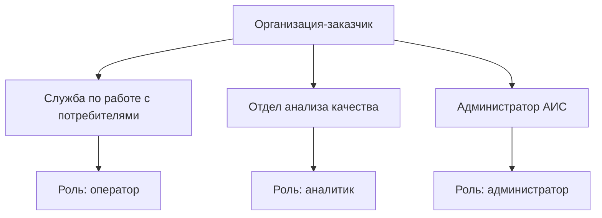
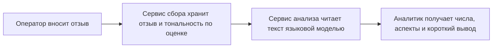
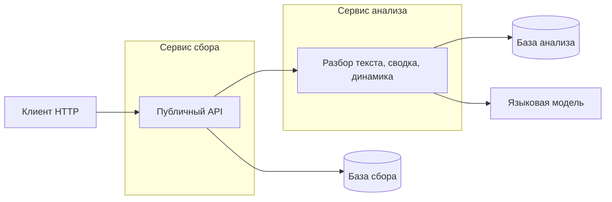
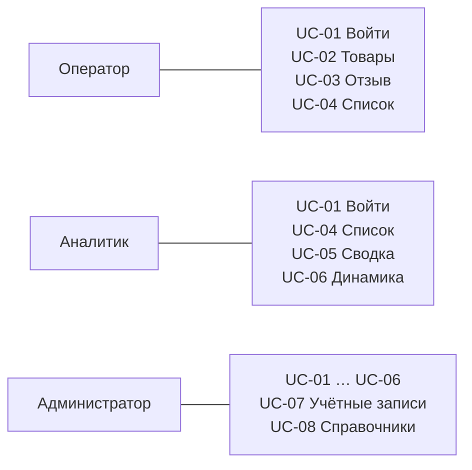
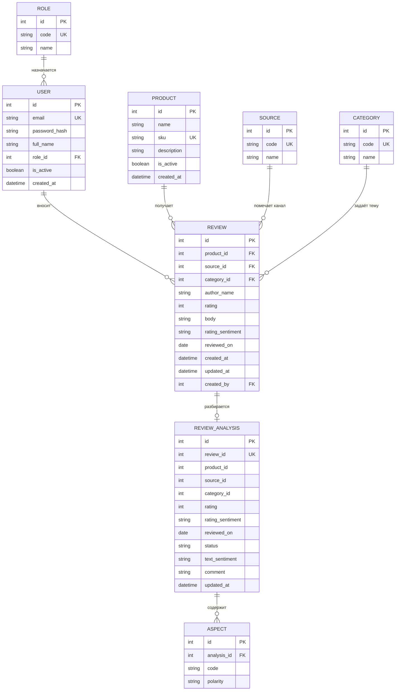

# Паспорт документа

| Реквизит | Значение |
| --- | --- |
| Код проекта | OTKLIK-01 |
| Наименование проекта | Автоматизированная информационная система сбора и анализа отзывов потребителей |
| Тип проекта | Разработка новой системы |
| Класс проекта | Прикладная информационная система |
| Тип сложности | Низкая |
| Наименование программы | Учебный проект. Отдельная программа не задана |
| Наименование портфеля | Не задан |
| Наименование бизнес-решения | Сбор и анализ отзывов потребителей |
| Наименование бизнес-системы | АИС «Отклик» |
| Название документа | Техническое задание на ИТ-решение |
| Версия документа | 1.1 |
| Дата документа | 11.10.2026 |
| Назначение документа | Зафиксировать цель, задачи, требования, сценарии и логическую модель данных серверной системы сбора и анализа отзывов |
| Аудитория | Автор работы, преподаватель, разработчик серверной части |

Состав разделов следует шаблону технического задания на ИТ-решение. Из примера ТЗ взяты описание вариантов использования, матрица ролей, перечень операций интерфейса и порядок приёмки. Устав проекта и концепция отдельными документами не выпускаются: решения, которые шаблон относит к ним, записаны здесь.

Первая очередь — два сервиса на FastAPI и две базы в одном PostgreSQL. Сервис сбора хранит отзывы. Сервис анализа читает текст языковой моделью и считает сводку. Экранного клиента нет. Отдельная служба на каждую таблицу, брокер сообщений и шлюз в эту очередь не входят.

## История изменений

| Версия | Дата | Автор | Комментарий |
| --- | --- | --- | --- |
| 1.0 | 11.10.2026 | Вячеслав Кочергин | Первая редакция |
| 1.1 | 11.10.2026 | Вячеслав Кочергин | Две службы: сбор и анализ. Разбор текста отзыва языковой моделью |

## Связанные документы

| Документ | Версия | Дата |
| --- | --- | --- |
| План управления проектом (устав) | Не выпускается | — |
| Концепция ИТ-решения | Не выпускается. Решения включены в настоящее ТЗ | 11.10.2026 |

## Согласование

| Должность | ФИО | Роль | Дата | Подпись |
| --- | --- | --- | --- | --- |
| Заказчик | Представитель организации-заказчика | Согласование требований | | |
| Исполнитель | Вячеслав Кочергин | Автор технического задания | 11.10.2026 | |

# 1. Термины и определения

| Термин | Определение |
| --- | --- |
| Система, АИС «Отклик» | Серверное приложение и его база данных, создаваемые по настоящему ТЗ |
| Потребитель | Человек, который оставил отзыв вне системы. Учётной записи потребителя в системе нет |
| Автор отзыва | Имя потребителя, сохранённое в отзыве |
| Оператор | Сотрудник, который заводит товары и вносит отзывы |
| Аналитик | Сотрудник, который читает отзывы и запрашивает показатели |
| Администратор | Сотрудник, который ведёт учётные записи, источники и темы и обладает правами оператора и аналитика |
| Товар | Продукт организации, к которому относится отзыв |
| Источник | Метка происхождения отзыва: ручной ввод, магазин, площадка. Подключение к площадке не выполняется |
| Тема | Одна предметная метка отзыва: качество, доставка, цена или сервис. У отзыва ровно одна тема |
| Оценка | Целое число от 1 до 5, которое указал потребитель |
| Тональность по оценке | Класс, который сервис сбора вычисляет по числу 1…5, без чтения текста |
| Разбор текста | Результат сервиса анализа: тональность текста, до трёх аспектов и одна короткая фраза. Его даёт языковая модель |
| Аспект | Одна из тем `quality`, `delivery`, `price`, `service`, которую модель нашла в тексте, с полярностью «за» или «против» |
| Сводка | Число отзывов, средняя оценка, разрезы и короткий текстовый вывод по уже посчитанным числам |
| Динамика | Средняя оценка и число отзывов по дням, неделям или месяцам. Считается без языковой модели |
| Сервис сбора | Служба FastAPI, которая хранит пользователей, справочники и отзывы и отдаёт публичный API |
| Сервис анализа | Служба FastAPI, которая хранит результат разбора и считает сводку и динамику |
| Языковая модель | Внешний HTTP-сервис с контрактом Chat Completions. Своя модель не обучается |
| Пользовательская история | Потребность роли в виде «как роль, я хочу действие, чтобы результат» |
| Вариант использования | Сценарий работы роли с системой: предусловия, основной поток, альтернативы, правила |
| API | Программный интерфейс HTTP/JSON. Единственный интерфейс первой очереди |
| Задача проекта | Работа, которую нужно выполнить, чтобы достичь цели. Задача не является функцией системы |

# 2. Цели и задачи проекта

У проекта одна цель. Четыре задачи — это работы, а не функции системы. Функции перечислены в п. 4.3 и закрывают те же истории, что и задачи.

## 2.1. Цель

**Ц-1.** Сократить подготовку сводной оценки мнения потребителей: отзыв сохраняется в сервисе сбора, а число, средняя оценка, тональность текста, аспекты и короткий вывод возвращает сервис анализа по одному запросу.

Критерии достижения цели приведены в п. 4.1.2. Отдельной второй цели у проекта нет.

## 2.2. Задачи

| ID | Цель | Задача | Зачем это цели |
| --- | --- | --- | --- |
| З-1 | Ц-1 | Разделить хранение отзыва и хранение результата его разбора | Сводка и разбор текста считаются по проекции, а не по чужой базе |
| З-2 | Ц-1 | Сделать публичный сервис сбора на FastAPI для записи и выборки отзывов | Отзыв сохраняется даже тогда, когда разбор текста недоступен |
| З-3 | Ц-1 | В отдельном сервисе анализа разобрать текст языковой моделью и посчитать сводку и динамику | Аналитик получает и числа, и смысл текста |
| З-4 | Ц-1 | Разделить доступ оператора, аналитика и администратора | Сбор и просмотр показателей выполняют назначенные сотрудники |

Задачи стыкуются последовательно и не подменяют друг друга:

1. З-1 задаёт данные сервиса сбора и данные сервиса анализа. Общего внешнего ключа между базами нет.
2. З-2 записывает отзыв и отдаёт его через публичный API.
3. З-3 разбирает текст и считает сводку и динамику. Числа считаются в его базе. Короткий вывод сводки делает языковая модель по уже готовым числам, а не по полной пачке текстов.
4. З-4 определяет, какая роль вызывает операции З-2 и З-3. Вход остаётся в сервисе сбора: отдельная служба доступа не выделяется.

У З-1 нет отдельной пользовательской истории: это основание для историй сбора и анализа. Проверка З-1 — истории US-02…US-06 выполняются на двух схемах раздела 6.

## 2.3. Декомпозиция задач

Порядок выполнения: З-1, затем каркас З-2.1 вместе со входом З-4.1, затем остальные операции З-2 и З-4, затем З-3. Проверка прав из З-4.2 включается вместе с каждой операцией.

### З-1. Модель данных

| ID | Работа | Результат |
| --- | --- | --- |
| З-1.1 | Создать таблицы сбора и таблицы разбора в двух базах PostgreSQL | Две миграции |
| З-1.2 | Задать ключи, уникальность, оценки и допустимые коды аспектов | Ограничения, которые нельзя обойти через API |
| З-1.3 | Заполнить роли, четыре темы и источник «Ручной ввод». Первого администратора создать при запуске сервиса сбора | База сбора готова принять отзыв |

### З-2. Сервис сбора

| ID | Работа | Результат |
| --- | --- | --- |
| З-2.1 | Поднять сервис сбора, его базу и OpenAPI | Сервис открывает `/docs` и проверяет свою базу |
| З-2.2 | Реализовать товары, запись и исправление отзыва. После сохранения передать проекцию в сервис анализа | Операции UC-02 и UC-03. Сбой анализа не отменяет запись |
| З-2.3 | Реализовать списки и подставить к странице готовый разбор текста | Операция UC-04 |

### З-3. Сервис анализа

| ID | Работа | Результат |
| --- | --- | --- |
| З-3.1 | Принять проекцию отзыва, вызвать языковую модель и сохранить тональность текста, аспекты и фразу | Разбор одного отзыва, статус `ready` или `failed` |
| З-3.2 | Вернуть числовую сводку и короткий вывод по уже посчитанным агрегатам | Операция UC-05 |
| З-3.3 | Вернуть динамику средней оценки без вызова модели | Операция UC-06 |

### З-4. Доступ

| ID | Работа | Результат |
| --- | --- | --- |
| З-4.1 | Принимать почту и пароль и выдавать токен | Операция UC-01 |
| З-4.2 | Проверять роль по матрице п. 4.3.3 | Чужая операция получает отказ 403 |
| З-4.3 | Вести учётные записи, источники и темы | Операции UC-07 и UC-08 |

## 2.4. Граница первой очереди

В первую очередь входят работы З-1…З-4 и только те функции, которые закрывают истории US-01…US-08.

На развитие, за пределами оценки этих задач, остаются:

- экранный и мобильный клиент;
- загрузка пакета отзывов из файла;
- сбор отзывов с площадок, почты и мессенджеров;
- диалог с моделью, дообучение и векторный поиск;
- брокер сообщений, шлюз и отдельная служба входа;
- ответ потребителю, модерация и уведомления;
- права на отдельные товары;
- удаление записей и отдельный журнал аудита в базе.

# 3. Исходные данные

## 3.1. Бизнес-правила

1. Отзыв относится ровно к одному товару, одному источнику и одной теме. Если в тексте несколько тем, оператор выбирает главную.
2. Оценка — целое число от 1 до 5.
3. Тональность по оценке вычисляется только по таблице ниже и хранится в сервисе сбора. Сотрудник её не вводит.

| Оценка | Код | Наименование |
| --- | --- | --- |
| 1 или 2 | `negative` | Отрицательная |
| 3 | `neutral` | Нейтральная |
| 4 или 5 | `positive` | Положительная |

4. Потребитель в систему не входит. Имя автора — атрибут отзыва.
5. Учётную запись создаёт администратор. Самостоятельной регистрации нет.
6. Новый отзыв можно связать только с активным товаром. Уже сохранённые отзывы неактивного товара остаются в базе и участвуют в показателях.
7. Дата отзыва не позже текущей даты в часовом поясе Europe/Moscow. Показатели группируются по дате отзыва, а не по дате ввода.
8. Записи первой очереди не удаляются. Пользователя и товар можно сделать неактивными.
9. Все роли работают с общим каталогом товаров. Отдельных витрин по подразделениям нет.
10. Источник — название канала, а не интеграция. Наличие источника «Маркетплейс» не означает запрос к маркетплейсу.
11. Тональность текста, аспекты и короткую фразу получает сервис анализа у языковой модели. Они могут не совпасть с тональностью по оценке. Сотрудник их не вводит и не правит.
12. Запись отзыва не ждёт модель. Если сервис анализа или модель недоступны, отзыв в сервисе сбора остаётся сохранённым.

### 3.1.1. Государственные стандарты

При составлении документа учитывался ГОСТ 34.602-2020 «Информационные технологии. Комплекс стандартов на автоматизированные системы. Техническое задание на создание автоматизированной системы»: выделены цель, требования к функциям, порядок контроля и приёмки.

### 3.1.2. Документы регулирования

В системе обрабатываются персональные данные сотрудников (фамилия и имя, адрес почты) и имя автора отзыва в том виде, в каком его внёс оператор. Состав таких данных учитывает Федеральный закон от 27.07.2006 № 152-ФЗ «О персональных данных».

Паспортные данные, телефоны, платежи и специальные категории персональных данных не обрабатываются. Система не проверяет, что имя автора принадлежит реальному человеку.

### 3.1.3. Стандарты организации

Корпоративный стандарт заказчика для учебного проекта не задан. Обязательные решения по данным, ролям и операциям — настоящий документ.

## 3.2. Организационный объём

| Подразделение | Роль в системе | Участие |
| --- | --- | --- |
| Служба по работе с потребителями | Оператор | Вносит товары и отзывы, читает список отзывов |
| Отдел анализа качества | Аналитик | Читает отзывы, сводку и динамику |
| Администратор АИС | Администратор | Ведёт учётные записи и справочники. Один человек, роль может быть совмещена |

Другие подразделения систему не используют.

## 3.3. Процессный объём

Затрагивается один процесс.

| Код | Процесс | Степень влияния |
| --- | --- | --- |
| КП-01 | Сбор и анализ отзывов потребителей | Меняется способ учёта: сервис сбора хранит отзыв, сервис анализа читает текст и считает сводку. Смысл шага прежний: отзыв связывается с товаром, источником и темой |

Сейчас оператор переносит отзывы в таблицу или оставляет их в письмах. Тональность и средняя оценка считаются вручную, если считаются вообще. Целевой ход процесса:

| Шаг | Как выполняется сейчас | Как выполняется в системе |
| --- | --- | --- |
| Зафиксировать отзыв | Таблица или письмо | Сервис сбора |
| Определить тон текста | Вручную или никак | Языковая модель в сервисе анализа |
| Получить среднюю оценку, аспекты и вывод | Ручной подсчёт и пересказ | Сводка и динамика сервиса анализа |

## 3.4. Смежные проекты

Смежных проектов нет. Первая очередь ни от какого параллельного проекта не зависит.

## 3.5. Бизнес-роли

| Роль | Описание |
| --- | --- |
| Оператор | Сотрудник службы по работе с потребителями. Заводит товары и переносит отзыв в систему по тексту, который получил вне системы |
| Аналитик | Сотрудник отдела анализа качества. Отбирает отзывы и читает сводку и динамику |
| Администратор | Назначает роли, заводит источники и темы. Для сопровождения ему доступны и операции оператора, и операции аналитика |
| Потребитель | В системе роли не имеет. Его имя хранится внутри отзыва |

# 4. Требования к системе

## 4.1. Назначение и цели создания системы

### 4.1.1. Назначение системы

АИС «Отклик» хранит отзывы и объясняет их текст. Сервис сбора принимает отзыв и сразу ставит тональность по оценке. Сервис анализа отдельно читает текст языковой моделью и по накопленным результатам отдаёт сводку и динамику. Сотрудники обращаются только к сервису сбора. Страниц и мобильного приложения в первой очереди нет: рабочий интерфейс приёмки — OpenAPI сервиса сбора.

### 4.1.2. Цель создания системы

Цель создания системы совпадает с целью проекта Ц-1.

| Цель | Показатель | Значение | Критерий |
| --- | --- | --- | --- |
| Ц-1 | Как получается сводка по выбранным фильтрам | Один запрос сводки | Показатели не переносятся во внешнюю таблицу для ручного счёта |
| Ц-1 | Время ответа списка и числовой сводки | Не более 2 секунд на наборе из 10 000 отзывов, без ожидания модели | Проверка на стенде из п. 4.4.2 |
| Ц-1 | Текстовый вывод сводки | Один абзац по уже посчитанным числам | Поле `conclusion` в ответе сводки. Модель не получает сырые тексты десяти тысяч отзывов |

## 4.2. Бизнес-требования

| ID | Требование | Какую задачу закрывает |
| --- | --- | --- |
| БТ-1 | Отзывы хранятся в сервисе сбора и выбираются по товару, периоду, источнику, теме, оценке и тональности по оценке | З-1, З-2 |
| БТ-2 | Числа сводки считаются сервисом анализа, а текст отзыва разбирает языковая модель: тональность текста, аспекты и короткий вывод | З-3 |
| БТ-3 | Запись отзывов и просмотр показателей доступны только сотруднику с подходящей ролью | З-4 |

### 4.2.1. Пользовательские истории

**US-01.** Как сотрудник с учётной записью, я хочу войти в систему, чтобы выполнять только операции своей роли. Задача З-4.

**US-02.** Как оператор, я хочу зарегистрировать товар, чтобы привязывать к нему отзывы. Задачи З-1 и З-2.

**US-03.** Как оператор, я хочу сохранить отзыв с оценкой и текстом, чтобы он сразу попал в хранилище и ушёл на разбор текста. Задачи З-1, З-2 и З-3.

**US-04.** Как аналитик, я хочу отобрать отзывы по товару, периоду, источнику, теме, оценке и тональности по оценке, чтобы читать конкретные мнения вместе с готовым разбором текста. Задача З-2.

**US-05.** Как аналитик, я хочу получить сводку по тем же фильтрам, чтобы видеть число, среднюю оценку, тональность текста, аспекты и короткий вывод без ручного пересказа. Задачи З-1 и З-3.

**US-06.** Как аналитик, я хочу получить динамику средней оценки по дням, неделям или месяцам, чтобы видеть, как меняется мнение. Задачи З-1 и З-3.

**US-07.** Как администратор, я хочу заводить сотрудников и назначать им роль, чтобы доступ совпадал с обязанностями. Задача З-4.

**US-08.** Как администратор, я хочу вести источники и темы, чтобы операторы помечали отзывы одинаково. Задачи З-1 и З-4.

Истории US-02…US-08 описывают работу сотрудников. Потребительской истории входа нет: потребитель в систему не допускается.

### 4.2.2. Сопоставление пользовательских историй и вариантов использования

Каждая история закрывается одним вариантом использования. Описание вариантов — в п. 4.3.4.

| Пользовательская история | Вариант использования |
| --- | --- |
| US-01 Войти в систему | UC-01 Войти в систему |
| US-02 Зарегистрировать товар | UC-02 Вести товары |
| US-03 Сохранить отзыв | UC-03 Записать отзыв |
| US-04 Отобрать отзывы | UC-04 Получить список отзывов |
| US-05 Получить сводку | UC-05 Получить сводную аналитику |
| US-06 Получить динамику | UC-06 Получить динамику оценок |
| US-07 Назначить роль сотруднику | UC-07 Управлять учётными записями |
| US-08 Вести источники и темы | UC-08 Вести справочники |

### 4.2.3. Согласованность цели, задач, историй и вариантов

| Цель | Задача | Истории | Варианты |
| --- | --- | --- | --- |
| Ц-1 | З-1 | US-02, US-03, US-05, US-06, US-08 | UC-02, UC-03, UC-05, UC-06, UC-08 |
| Ц-1 | З-2 | US-02, US-03, US-04 | UC-02, UC-03, UC-04 |
| Ц-1 | З-3 | US-03, US-05, US-06 | UC-03, UC-05, UC-06 |
| Ц-1 | З-4 | US-01, US-07, US-08 | UC-01, UC-07, UC-08 |

US-03 стоит и в З-2, и в З-3: сервис сбора сохраняет отзыв и тональность по оценке, сервис анализа после этого читает текст. Отдельной истории «вызвать модель» нет.

## 4.3. Функциональные требования

### 4.3.1. Функции системы

Функция — поведение системы. Она не заменяет задачу из раздела 2. Набор функций совпадает с вариантами использования и шире него не становится.

| ID | Функция | Что делает | История | Вариант | Требование |
| --- | --- | --- | --- | --- | --- |
| Ф-1 | Аутентификация | Проверяет почту и пароль, выдаёт токен | US-01 | UC-01 | БТ-3 |
| Ф-2 | Ведение товаров | Создаёт и изменяет товар, отдаёт список | US-02 | UC-02 | БТ-1 |
| Ф-3 | Запись отзыва | Сохраняет отзыв, ставит тональность по оценке и передаёт текст в сервис анализа | US-03 | UC-03 | БТ-1, БТ-2 |
| Ф-4 | Выборка отзывов | Отдаёт страницу отзывов и подставляет готовый разбор | US-04 | UC-04 | БТ-1 |
| Ф-5 | Сводная аналитика | Считает числа по проекции и просит модель о коротком выводе по этим числам | US-05 | UC-05 | БТ-2 |
| Ф-6 | Динамика оценок | Считает среднюю оценку по периодам | US-06 | UC-06 | БТ-2 |
| Ф-7 | Учётные записи | Создаёт пользователя и меняет роль, имя, активность и пароль | US-07 | UC-07 | БТ-3 |
| Ф-8 | Справочники | Отдаёт и пополняет источники и темы | US-08 | UC-08 | БТ-1 |

#### 4.3.1.1. Функциональная модель

Уместны две службы, не больше. Сбор и анализ меняются по разным причинам: отзыв нужно сохранить даже при отказе модели, а разбор текста зависит от внешнего сервиса и отвечает медленнее. Поэтому у каждого своя база и свой процесс FastAPI.

Отдельная служба на пользователей, товары или темы была бы лишней: эти данные меняются вместе с отзывом и не имеют собственного внешнего контракта. Шлюз, брокер и служба только для входа в первую очередь не входят. Публичный API один — у сервиса сбора. Он проверяет роль и для сводки, динамики и повторного разбора вызывает сервис анализа.

| Функция | Служба | Данные |
| --- | --- | --- |
| Ф-1, Ф-2, Ф-3, Ф-4, Ф-7, Ф-8 | Сбор | Пользователь, роль, товар, отзыв, источник, тема. Тональность по оценке хранится здесь |
| Ф-5, Ф-6 и разбор текста из Ф-3 | Анализ | Проекция отзыва, тональность текста, аспекты, фраза. Текста отзыва эта база не хранит |

Клиентом HTTP может быть инструмент приёмки или страница OpenAPI сервиса сбора. Сам клиент в состав системы не входит.

### 4.3.2. Требования к интеграции

Смежных учётных систем нет. Обмен с маркетплейсами, почтой и файлами не ведётся. Внешний компонент один: языковая модель по HTTP.

| Смежная система | Что передаётся |
| --- | --- |
| Языковая модель | Текст одного отзыва и оценка — на разбор. На сводку — только агрегаты: число, средняя оценка, доли тональности текста, частоты аспектов. Сырой массив отзывов модели не отправляется |
| Площадки и почта | Не вызываются. Источник отзыва остаётся справочной меткой |

#### 4.3.2.1. Интеграционная архитектура

Публичный интерфейс — сервис сбора: HTTP, JSON, UTF-8, префикс `/api/v1`, описание в `/docs` и `/openapi.json`. Состав операций — п. 4.3.5.

Сервис анализа слушает только внутренние вызовы сервиса сбора. Общий секрет передаётся заголовком `X-Internal-Token`, переменная `INTERNAL_TOKEN`. Пользовательский токен сервис анализа не выдаёт и не проверяет: роль уже проверена сервисом сбора.

Языковая модель вызывается по контракту Chat Completions, `POST {LLM_BASE_URL}/chat/completions`. Адрес, ключ и имя модели задаются переменными `LLM_BASE_URL`, `LLM_API_KEY`, `LLM_MODEL`. Температура запроса — 0. Своя модель не размещается и не дообучается. На приёмке вместо внешней модели допустима заглушка с тем же контрактом и заранее известным JSON для контрольной фразы.

#### 4.3.2.2. Информационные потоки

1. Оператор передаёт отзыв сервису сбора. Тот ставит тональность по оценке, сохраняет отзыв и отвечает, не дожидаясь модели. Затем передаёт сервису анализа идентификаторы, оценку, дату, тему, источник и текст.
2. Сервис анализа сохраняет проекцию со статусом `pending`, вызывает модель и записывает тональность текста, не больше трёх аспектов и фразу до 300 знаков. Текст отзыва в базе анализа не остаётся. При ошибке статус `failed`, проекция с оценкой сохраняется.
3. Аналитик запрашивает список у сервиса сбора. Тот читает свою базу и для идентификаторов страницы забирает готовый разбор у сервиса анализа.
4. Аналитик запрашивает сводку или динамику. Сервис сбора проверяет роль и вызывает сервис анализа. Числа считаются по проекции. Короткий вывод сводки модель пишет по агрегатам, не по текстам.
5. Администратор ведёт учётные записи и справочники только в сервисе сбора.

Повторный разбор одного отзыва — операция API-20. Она снова передаёт текст в сервис анализа.

#### 4.3.2.3. Логическая модель данных

В сервисе сбора шесть сущностей: роль, пользователь, товар, источник, тема, отзыв. В сервисе анализа две: разбор отзыва и аспект. Общего внешнего ключа нет, отзыв и разбор связаны логическим `review_id`. Состав атрибутов и ER-диаграмма — в разделе 6.

### 4.3.3. Функциональные роли

Роль хранится в учётной записи. Прав на отдельный товар нет.

| Функция | Администратор | Оператор | Аналитик |
| --- | --- | --- | --- |
| Ф-1 Вход | да | да | да |
| Ф-2 Товары: список | да | да | да |
| Ф-2 Товары: создание и изменение | да | да | нет |
| Ф-3 Запись и исправление отзыва | да | да | нет |
| Ф-4 Список отзывов | да | да | да |
| Ф-5 Сводка | да | нет | да |
| Ф-6 Динамика | да | нет | да |
| Ф-7 Учётные записи | да | нет | нет |
| Ф-8 Источники и темы: список | да | да | да |
| Ф-8 Источники и темы: создание и правка названия | да | нет | нет |

Чтение справочников нужно всем ролям, чтобы понимать фильтры и карточки отзывов. Сводку оператор не получает: для проверки введённого отзыва ему достаточно списка.

Ожидаемое число пользователей на учебном стенде: 1 администратор, до 5 операторов, до 5 аналитиков.

### 4.3.4. Сценарии работы системы

Общие предусловия для UC-02…UC-08:

1. Учётная запись создана и активна.
2. Пользователь получил действующий токен по UC-01 и передаёт его в заголовке `Authorization: Bearer` вместе с токеном.
3. Роль допускается к операции матрицей п. 4.3.3.

Общие альтернативы для этих вариантов:

- **А0. Нет действующего токена.** Система отвечает 401 и операцию не выполняет.
- **А0. Роль не допускается.** Система отвечает 403 с сообщением «Недостаточно прав» и данные не меняет.

Ниже эти две альтернативы в каждом варианте не повторяются. На рисунке 4 те же варианты разложены по ролям, без пересечения связей: у оператора четыре, у аналитика четыре, у администратора все восемь. Источник соответствия — матрица п. 4.3.3.

#### 4.3.4.1. UC-01. Войти в систему

**Связь.** US-01, Ф-1, З-4, БТ-3.

**Описание.** Сотрудник получает токен доступа.

**Предусловия.** Администратор заранее создал учётную запись. Для самого первого входа её создаёт запуск системы из переменных окружения, см. UC-07.

**Основной поток.**

1. Пользователь передаёт почту и пароль.
2. Система находит активную учётную запись с этой почтой и проверяет пароль по хешу.
3. Система возвращает токен, тип `bearer` и код роли.
4. Следующие запросы передают этот токен.

**Альтернатива А1. Вход не выполнен.** Почта неизвестна, пароль неверен или учётная запись неактивна. Система отвечает 401 текстом «Неверная почта или пароль» и не сообщает, какая из трёх проверок не прошла. Токен не выдаётся.

**Правила.**

1. Срок токена — 8 часов. Отдельного токена обновления нет.
2. Алгоритм подписи — HS256. Секрет хранится вне исходного кода.
3. Пароль в ответе и в журнале не появляется.

#### 4.3.4.2. UC-02. Вести товары

**Связь.** US-02, Ф-2, З-1, З-2, БТ-1.

**Описание.** Оператор или администратор заводит товар и при необходимости меняет его карточку. Аналитик карточки только читает.

**Основной поток. Создать товар.**

1. Пользователь передаёт название, при необходимости артикул и описание.
2. Система проверяет поля по п. 4.3.5.
3. Система сохраняет активный товар и возвращает его вместе с идентификатором.

**Альтернатива А1. Такой артикул уже есть.** Непустой артикул совпал с уже сохранённым. Система отвечает 409 и товар не создаёт.

**Альтернатива А2. Изменить товар.** Пользователь передаёт идентификатор и новые название, артикул, описание или признак активности. Система проверяет поля и сохраняет изменения. Отзывы товара остаются на месте.

**Альтернатива А3. Просмотреть товары.** Любая вошедшая роль запрашивает список. Система возвращает страницу товаров, включая неактивные, вместе с общим числом.

**Правила.**

1. Неактивный товар нельзя указать в новом отзыве и при смене товара у существующего отзыва.
2. Пустой артикул означает отсутствие артикула. Несколько товаров без артикула допустимы.
3. Удаления товара нет.

#### 4.3.4.3. UC-03. Записать отзыв

**Связь.** US-03, Ф-3, З-1, З-2, З-3, БТ-1, БТ-2.

**Описание.** Оператор или администратор сохраняет отзыв. Сервис сбора сам ставит тональность по оценке и передаёт текст на разбор.

**Основной поток.**

1. Пользователь передаёт товар, источник, тему, имя автора, оценку, текст и дату отзыва.
2. Сервис сбора проверяет поля, наличие источника и темы и то, что товар существует и активен.
3. Сервис сбора вычисляет тональность по оценке по таблице п. 3.1.
4. Сервис сбора сохраняет отзыв, автора записи из токена, время создания и время изменения.
5. Сервис сбора возвращает отзыв вместе с тональностью по оценке, статусом разбора `pending` и названиями товара, источника и темы. Ответ не ждёт модель.
6. После ответа сервис сбора передаёт сервису анализа проекцию: идентификатор отзыва, товар, источник, тему, оценку, тональность по оценке, дату и текст.
7. Сервис анализа сохраняет проекцию и запрашивает у модели JSON: `text_sentiment`, не больше трёх аспектов с кодом темы и полярностью `positive` или `negative`, фразу `comment` до 300 знаков.
8. При разборе по схеме статус становится `ready`. Текст отзыва в базе анализа не хранится.

**Альтернатива А1. Поля не прошли проверку.** Нарушены правила п. 4.3.5, в том числе оценка вне диапазона 1…5 или дата отзыва в будущем. Сервис сбора отвечает 422 и отзыв не сохраняет.

**Альтернатива А2. Товар не принимает отзывы.** Товара нет: ответ 404. Товар неактивен: ответ 422 с текстом «Товар недоступен для новых отзывов».

**Альтернатива А3. Исправить отзыв.** Пользователь передаёт идентификатор и изменяемые поля. Сервис сбора повторяет проверки, пересчитывает тональность по оценке и снова передаёт проекцию. Предыдущий разбор заменяется новым со статусом `pending`.

**Альтернатива А4. Разбор не удался.** Сервис анализа или модель недоступны, либо ответ модели не совпал со схемой. Отзыв в сервисе сбора остаётся. Статус разбора — `failed`. Оператор или администратор может повторить разбор операцией API-20.

**Правила.**

1. В запросе нет полей тональности и нет автора записи. Тональность по оценке ставит сервис сбора, разбор текста — сервис анализа.
2. При нулевой длине текста или имени автора отзыв не сохраняется.
3. Удаления отзыва нет.
4. Аспект имеет только код `quality`, `delivery`, `price` или `service`. Другие коды отбрасываются. Повтор одного кода в одном разборе не хранится.

#### 4.3.4.4. UC-04. Получить список отзывов

**Связь.** US-04, Ф-4, З-2, БТ-1.

**Описание.** Сотрудник получает страницу отзывов. Любая роль из матрицы может читать список: оператору это нужно, чтобы увидеть внесённый отзыв.

**Основной поток.**

1. Пользователь передаёт фильтр. Все условия необязательны: товар, источник, тема, тональность по оценке, оценка, дата начала, дата конца, размер страницы и сдвиг. Тональность текста фильтром списка не является.
2. Сервис сбора проверяет, что переданные идентификаторы существуют, а дата начала не позже даты конца.
3. Сервис сбора возвращает отзывы своей базы, у которых выполнены все заданные условия, и общее число таких отзывов. Для идентификаторов страницы он запрашивает разбор у сервиса анализа.
4. Порядок: дата отзыва по убыванию, затем идентификатор по убыванию.

**Альтернатива А1. Ничего не найдено.** Условия корректны, подходящих отзывов нет. Система отвечает успехом и пустой страницей. Это не ошибка.

**Альтернатива А2. Фильтр ссылается на неизвестный объект.** Идентификатора товара, источника или темы нет в базе. Система отвечает 404.

**Правила.**

1. В элемент списка входят идентификаторы и названия товара, источника и темы, имя автора, оценка, тональность по оценке, текст, дата отзыва, время записи, а также статус разбора, тональность текста, аспекты и фраза, если разбор уже готов.
2. Размер страницы по умолчанию — 20, наибольший — 100, сдвиг по умолчанию — 0.
3. Если сервис анализа не ответил на запрос страницы, список отзывов всё равно возвращается. Поля разбора у элементов пустые, статус на странице помечается как неизвестный. Это не ошибка записи отзыва.

#### 4.3.4.5. UC-05. Получить сводную аналитику

**Связь.** US-05, Ф-5, З-1, З-3, БТ-2.

**Описание.** Аналитик или администратор получает показатели одного набора отзывов и короткий вывод по ним.

**Основной поток.**

1. Пользователь передаёт необязательные фильтры: товар, источник, тема, дата начала, дата конца.
2. Сервис сбора проверяет роль и вызывает сервис анализа.
3. Сервис анализа отбирает проекции с теми же фильтрами. В числовую сводку входят и проекции со статусом `failed`: у них есть оценка, но нет тональности текста.
4. Сервис анализа возвращает:
   - общее число отзывов;
   - среднюю оценку;
   - три строки тональности по оценке и три строки тональности текста, в порядке `positive`, `neutral`, `negative`: код, число, доля в процентах;
   - строки по темам и по источникам, у которых число больше нуля: идентификатор, код, название, число, средняя оценка;
   - строки аспектов, у которых число больше нуля: код, полярность, число;
   - поле `conclusion`: один абзац на русском до 500 знаков.
5. Строки тем, источников и аспектов упорядочены по числу отзывов от большего к меньшему.
6. Для `conclusion` модель получает только агрегаты этого ответа, не тексты отзывов.

**Альтернатива А1. Отзывов в фильтре нет.** Число равно 0, средняя оценка пустая, доли нулевые, списки пустые, `conclusion` пустой. Ответ успешный.

**Альтернатива А2. Модель не дала вывод.** Числовая часть возвращается с кодом 200. `conclusion` пустой.

**Правила.**

1. Средняя оценка — сумма оценок, делённая на число отзывов, в ответе не более двух знаков после запятой, значение 0,5 округляется от нуля.
2. Доля в процентах считается отдельно для тональности по оценке и для тональности текста. Делитель тональности текста — число проекций со статусом `ready`. Делитель тональности по оценке — все проекции фильтра. Округление как раньше, расхождение суммы долей с 100 допустимо в пределах 0,1.
3. Числовая сводка данные отзыва не изменяет. Вызов модели для `conclusion` не запускает повторный разбор каждого отзыва.
4. Запрос числовой сводки без вывода задаётся параметром `include_conclusion=false`. Его используют для замера времени на 10 000 отзывов.

#### 4.3.4.6. UC-06. Получить динамику оценок

**Связь.** US-06, Ф-6, З-1, З-3, БТ-2.

**Описание.** Аналитик или администратор получает среднюю оценку по периодам.

**Основной поток.**

1. Пользователь передаёт те же фильтры, что в UC-05, и размер периода: `day`, `week` или `month`. Если размер не передан, система берёт неделю.
2. Сервис анализа группирует проекции по дате отзыва. Модель для динамики не вызывается.
3. Неделя начинается в понедельник по ISO 8601. Месяц — календарный. День — календарная дата.
4. Система возвращает точки по возрастанию даты начала периода. В точке: дата начала, число отзывов, средняя оценка по правилу UC-05.

**Альтернатива А1. В периоде нет отзывов.** Такой период в ответ не включается. Пустой набор даёт пустой список точек и успешный ответ.

**Альтернатива А2. Неизвестный размер периода.** Система отвечает 422 и точки не считает.

**Правила.** Операция данные не изменяет. Часовой пояс на группировку даты отзыва не влияет: хранится календарная дата.

#### 4.3.4.7. UC-07. Управлять учётными записями

**Связь.** US-07, Ф-7, З-4, БТ-3.

**Описание.** Администратор заводит сотрудника и меняет его доступ.

**Предусловие первого запуска.** Если пользователей ещё нет, при старте система создаёт администратора из переменных окружения `ADMIN_EMAIL`, `ADMIN_PASSWORD` и `ADMIN_FULL_NAME`. Если пользователей нет и переменные не заданы, система не открывает операции сбора и пишет причину в журнал.

**Основной поток. Создать пользователя.**

1. Администратор передаёт почту, имя, пароль и код роли `admin`, `operator` или `analyst`.
2. Система проверяет поля и уникальность почты.
3. Система сохраняет активную учётную запись с хешем пароля и возвращает карточку без пароля и без хеша.

**Альтернатива А1. Почта уже используется.** Система отвечает 409 и вторую запись не создаёт.

**Альтернатива А2. Изменить пользователя.** Администратор меняет имя, роль, активность или пароль. Нужно передать хотя бы одно поле. Новый пароль сохраняется только как хеш.

**Альтернатива А3. Попытка отключить себя.** Администратор переводит собственную учётную запись в неактивные. Система отвечает 422 текстом «Нельзя деактивировать свою учётную запись» и запись не меняет.

**Альтернатива А4. Список пользователей.** Администратор получает страницу карточек: идентификатор, почта, имя, код и название роли, активность, время создания.

**Правила.**

1. Удаления учётной записи нет. Доступ закрывается признаком неактивности.
2. Неактивный пользователь не входит по UC-01.
3. В любом ответе нет пароля и хеша пароля.

#### 4.3.4.8. UC-08. Вести справочники

**Связь.** US-08, Ф-8, З-1, З-4, БТ-1.

**Описание.** Администратор пополняет источники и темы. Остальные роли их читают. Коды начального наполнения заданы в п. 6.6.

**Основной поток. Создать источник или тему.**

1. Администратор передаёт название и код.
2. Система проверяет формат кода и уникальность кода внутри этого справочника.
3. Система сохраняет запись и возвращает её.

**Альтернатива А1. Код уже есть.** Система отвечает 409 и запись не создаёт.

**Альтернатива А2. Переименовать.** Администратор меняет только название. Код остаётся прежним, чтобы уже сохранённые ссылки не меняли смысла.

**Альтернатива А3. Прочитать справочник.** Любая вошедшая роль получает полный список. Страницы для этих двух справочников не требуются: их объём маленький. Порядок — по названию.

**Правила.** Удаления источника и темы нет. Источник не инициирует обмен с внешней площадкой.

### 4.3.5. Операции интерфейса и правила полей

Экранных форм нет. Вместо них фиксируется контракт API: его достаточно, чтобы выполнить истории без отдельного клиента. Тело запроса и ответа — JSON.

| ID | Метод и путь | Назначение | Кто вызывает | Вариант |
| --- | --- | --- | --- | --- |
| API-01 | `POST /api/v1/auth/login` | Вход | любая роль, без токена | UC-01 |
| API-02 | `GET /api/v1/users` | Список сотрудников | администратор | UC-07 |
| API-03 | `POST /api/v1/users` | Создать сотрудника | администратор | UC-07 |
| API-04 | `PATCH /api/v1/users/{id}` | Изменить сотрудника | администратор | UC-07 |
| API-05 | `GET /api/v1/products` | Список товаров | все роли | UC-02 |
| API-06 | `POST /api/v1/products` | Создать товар | администратор, оператор | UC-02 |
| API-07 | `PATCH /api/v1/products/{id}` | Изменить товар | администратор, оператор | UC-02 |
| API-08 | `GET /api/v1/sources` | Список источников | все роли | UC-08 |
| API-09 | `POST /api/v1/sources` | Создать источник | администратор | UC-08 |
| API-10 | `PATCH /api/v1/sources/{id}` | Переименовать источник | администратор | UC-08 |
| API-11 | `GET /api/v1/categories` | Список тем | все роли | UC-08 |
| API-12 | `POST /api/v1/categories` | Создать тему | администратор | UC-08 |
| API-13 | `PATCH /api/v1/categories/{id}` | Переименовать тему | администратор | UC-08 |
| API-14 | `POST /api/v1/reviews` | Записать отзыв | администратор, оператор | UC-03 |
| API-15 | `GET /api/v1/reviews` | Список отзывов | все роли | UC-04 |
| API-16 | `PATCH /api/v1/reviews/{id}` | Исправить отзыв | администратор, оператор | UC-03 |
| API-17 | `GET /api/v1/analytics/summary` | Сводка и короткий вывод | администратор, аналитик | UC-05 |
| API-18 | `GET /api/v1/analytics/dynamics` | Динамика | администратор, аналитик | UC-06 |
| API-19 | `GET /api/v1/health` | Проверка сервиса сбора, его базы и доступности сервиса анализа | без токена | п. 4.4.2.6 |
| API-20 | `POST /api/v1/reviews/{id}/analysis` | Повторить разбор текста | администратор, оператор | UC-03 |

Списки пользователей, товаров и отзывов возвращают объект с полями `items`, `total`, `limit`, `offset`. `total` — число записей, подходящих под фильтр, а не размер страницы.

Внутренние операции сервиса анализа не входят в публичную схему. Их вызывает только сервис сбора с заголовком `X-Internal-Token`:

| Операция | Назначение |
| --- | --- |
| `POST /internal/reviews` | Создать или заменить проекцию и запустить разбор |
| `GET /internal/analyses` | Отдать разборы по списку идентификаторов отзывов |
| `GET /internal/analytics/summary` | Числовая сводка и, по параметру, текстовый вывод |
| `GET /internal/analytics/dynamics` | Динамика |

| Ситуация | Код HTTP |
| --- | --- |
| Нет токена, токен просрочен или повреждён, неверная пара почта/пароль | 401 |
| Роль не допускается к операции | 403 |
| Нет сущности с указанным идентификатором | 404 |
| Почта, артикул или код справочника уже заняты | 409 |
| Поля нарушают правила ниже | 422 |

Сообщения отказов по правилам этого ТЗ — на русском языке. Ошибки формата полей допустимо возвращать стандартным телом FastAPI.

| Поле | Правило |
| --- | --- |
| Почта | Непустой адрес, уникальный среди пользователей |
| Пароль | От 8 до 128 символов. В базе хранится только хеш |
| Имя сотрудника | От 1 до 200 символов |
| Код роли | `admin`, `operator` или `analyst` |
| Название товара | От 1 до 300 символов |
| Артикул | Пусто либо от 1 до 64 символов. Непустой артикул уникален |
| Описание товара | Пусто либо до 2000 символов |
| Название источника или темы | От 1 до 200 символов |
| Код источника или темы | От 2 до 32 символов: латиница в нижнем регистре, цифры и `_`, первый символ — буква. Уникален в своём справочнике |
| Имя автора отзыва | От 1 до 200 символов |
| Оценка | Целое от 1 до 5 |
| Текст отзыва | От 1 до 4000 символов |
| Дата отзыва | Календарная дата `YYYY-MM-DD`, не позже текущей даты в Europe/Moscow |
| Тональность по оценке и тональность текста | Только `positive`, `neutral`, `negative`. В запрос записи не входят |
| Статус разбора | `pending`, `ready` или `failed`. Его ставит сервис анализа |
| Полярность аспекта | `positive` или `negative` |
| Размер периода динамики | `day`, `week` или `month` |
| `limit` | Целое от 1 до 100. По умолчанию 20 |
| `offset` | Целое от 0. По умолчанию 0 |

## 4.4. Нефункциональные требования

Нефункциональные требования ограничивают первую очередь и не добавляют функций сверх раздела 4.3.

| ID | Требование | К каким функциям относится |
| --- | --- | --- |
| НФ-1 | Список, числовая сводка и динамика на 10 000 отзывов отвечают не дольше 2 секунд и не вызывают модель | Ф-4, Ф-5, Ф-6 |
| НФ-2 | Публичные операции, кроме входа и проверки здоровья, требуют действующий токен | Ф-2…Ф-8 |
| НФ-3 | Пароль хранится только как хеш bcrypt или argon2id | Ф-1, Ф-7 |
| НФ-4 | Публичный интерфейс — HTTP JSON сервиса сбора. Экранных форм нет | все функции |
| НФ-5 | Состав публичных операций совпадает с таблицей API-01…API-20 | все функции |
| НФ-6 | Отказ модели или сервиса анализа не отменяет уже принятый отзыв. Ожидание одного разбора и вывода сводки — не дольше 20 секунд, после чего статус `failed` или пустой `conclusion` | Ф-3, Ф-5 |

### 4.4.1. Реализация нефункциональных требований

НФ-1 обеспечивается базой анализа и отбором по ключам товара, источника, темы и даты отзыва. НФ-2 и НФ-3 обеспечивает сервис сбора. НФ-6 обеспечивается тем, что запись отзыва завершается до вызова модели.

### 4.4.2. Инфраструктура и каналы связи

Стенд разработки и стенд приёмки устроены одинаково: одна машина, на ней два процесса FastAPI и один PostgreSQL с двумя базами.

| Узел | Состав | Назначение |
| --- | --- | --- |
| Одна машина | 2 процессорных ядра, 4 ГБ памяти, 20 ГБ диска, ОС Linux | Сервис сбора, сервис анализа и PostgreSQL 16 |

Отдельные контуры разработки, теста и промышленной эксплуатации не требуются.

#### 4.4.2.1. Технологическая архитектура

Оба сервиса запускаются процессами ASGI (Uvicorn). У каждого своя база в одном экземпляре PostgreSQL. Схемы меняются только собственными миграциями службы. Общего внешнего ключа между базами нет.

#### 4.4.2.2. Канал клиент—сервер

Для учебного стенда достаточно локального обращения к API. Отдельная полоса на пользователя не нормируется.

#### 4.4.2.3. Распределённая серверная инфраструктура

Географически распределённых узлов нет. Требование к каналу между площадками не предъявляется.

#### 4.4.2.4. Канал высокой доступности

Резервная площадка не создаётся. Отдельный канал репликации не требуется.

#### 4.4.2.5. Отказоустойчивость и катастрофоустойчивость

Кластер высокой доступности и катастрофоустойчивая площадка в первую очередь не входят. После перезапуска машины система продолжает работу, если файлы базы сохранены.

#### 4.4.2.6. Диагностирование

Операция API-19 возвращает успех, если сервис сбора работает, его база отвечает и сервис анализа достижим. Если база сбора недоступна, операция возвращает 503. Недоступность только языковой модели успехом API-19 не считается отказом сбора: её показывает статус разбора. Журнал каждой службы содержит время, код операции и результат. Пароль, хеш пароля, ключ модели и полный токен в журнал не пишутся.

#### 4.4.2.7. Развитие и модернизация

Новая операция добавляется новым путём и не меняет смысл уже описанных путей. Изменение состава полей базы выполняется новой миграцией. Работы раздела 2.4 в оценку первой очереди не входят.

#### 4.4.2.8. Персонал

Для сопровождения стенда достаточно одного человека с правами администратора: он устанавливает среду, задаёт переменные первого входа и выполняет миграции. Операторы и аналитики систему не администрируют.

Квалификация разработчика первой очереди: Python, FastAPI, реляционная база, HTTP и вызов языковой модели по готовому контракту.

#### 4.4.2.9. Надёжность

При ошибке проверки полей уже сохранённые отзывы не изменяются. Потеря соединения с базой во время запроса завершается ошибкой этого запроса и не очищает таблицы.

#### 4.4.2.10. Резервное копирование

Резервная копия — дамп PostgreSQL. На учебном стенде дамп снимается перед приёмкой после загрузки контрольных отзывов. Отдельный план аварийного восстановления площадки не требуется.

#### 4.4.2.11. Доступность и производительность

| Параметр | Описание | Как проверяется | Порог |
| --- | --- | --- | --- |
| Ответ списка | `GET /api/v1/reviews` на 10 000 отзывов | Замер на стенде п. 4.4.2 | не более 2 с |
| Ответ сводки | `GET /api/v1/analytics/summary` на том же наборе | Замер на стенде | не более 2 с |
| Ответ динамики | `GET /api/v1/analytics/dynamics` на том же наборе | Замер на стенде | не более 2 с |
| Доступность стенда | Учебный стенд | Окно работы назначает исполнитель | круглосуточный режим не требуется |

Набор из 10 000 отзывов нужен только для замера НФ-1. Для функциональной приёмки достаточно контрольного набора из п. 4.4.15.

#### 4.4.2.12. Масштабируемость

Рост объёма в пределах учебного стенда обеспечивается ресурсами той же машины. Шардирование и несколько экземпляров приложения не требуются.

### 4.4.3. Архитектура размещения

На машине стенда работают сервис сбора, сервис анализа и PostgreSQL. Рисунок 3 показывает эту схему. Отдельная диаграмма сетевого оборудования не требуется: сеть стенда локальная.

### 4.4.4. Режимы функционирования

В обычном режиме доступны операции API-01…API-20. На время миграции своей базы останавливается только соответствующий сервис, затем он запускается снова. Отказ базы сбора останавливает запись и чтение отзывов. Отказ базы анализа или модели не удаляет уже сохранённые отзывы.

### 4.4.5. Внешняя среда

Достаточно обычного электропитания рабочей станции или виртуальной машины. Отдельных требований к кондиционированию и инженерным системам нет.

### 4.4.6. Конфиденциальность

В базе хранятся учётные данные сотрудников и имена авторов отзывов. Эти сведения не публикуются открыто: их возвращают только операции с действующим токеном. Коммерческая тайна заказчика и государственная тайна не обрабатываются.

Секрет подписи токена, секрет внутреннего вызова, строка подключения к каждой базе, адрес модели, ключ и имя модели задаются переменными окружения и в репозиторий исходного кода не помещаются.

### 4.4.7. Безопасность

1. Пароль проверяется по хешу bcrypt или argon2id.
2. Доступ к операциям, кроме API-01 и API-19, требует токен HS256.
3. Роль проверяется на сервере по матрице п. 4.3.3. Скрытие операции на стороне клиента требованием не является, потому что клиента в поставке нет.
4. Запрос с токеном неактивного пользователя выполняется как запрос без действительного входа: ответ 401.
5. На локальном стенде допустим HTTP. При размещении не на локальной машине канал — HTTPS.
6. Межсайтовые ограничения браузера не настраиваются: браузерного клиента в первой очереди нет.

### 4.4.8. Эргономика

Пользовательского экрана нет. Понятность интерфейса для разработчика и приёмки означает предсказуемые коды HTTP, русские сообщения бизнес-отказов и читаемую схему OpenAPI.

### 4.4.9. Техническая поддержка

На время учебной работы сопровождение выполняет исполнитель. Отдельный регламент гарантийного обслуживания не требуется.

### 4.4.10. Лицензирование

Используются свободно распространяемые Python, FastAPI, SQLAlchemy, Alembic, PostgreSQL и библиотеки хеширования и JWT в пределах их лицензий. Отдельная коммерческая лицензия для первой очереди не закупается.

### 4.4.11. Виды обеспечения

#### 4.4.11.1. Математическое обеспечение

Числовая сводка и динамика считаются по правилам UC-05 и UC-06: среднее арифметическое оценок, доля тональности, группировка по календарному периоду. Разбор одного текста и абзац `conclusion` выполняет внешняя языковая модель по контракту п. 4.3.2.1. Своя модель не обучается, статистические критерии не применяются.

#### 4.4.11.2. Программное обеспечение

| Компонент | Чем обеспечивается |
| --- | --- |
| Сервис сбора и сервис анализа | Python 3.12 или новее, FastAPI, Uvicorn, Pydantic. Два отдельных приложения |
| Доступ к данным | SQLAlchemy 2, Alembic, у каждой службы свои миграции |
| Базы | PostgreSQL 16, базы `reviews` и `analysis` |
| Доступ | библиотека JWT (HS256), bcrypt или argon2id |
| Языковая модель | HTTP-клиент к контракту Chat Completions |
| Клиент | В поставку не входит |

Каталоги кода не фиксируются. Обязательно само разделение на два запускаемых приложения. Модуль входа живёт в сервисе сбора.

#### 4.4.11.3. Техническое обеспечение

Достаточно машины из п. 4.4.2. Специальные устройства не требуются.

#### 4.4.11.4. Методическое обеспечение

Методика тональности по оценке — таблица п. 3.1. Методика разбора текста — контракт JSON в UC-03. Других методических документов не требуется.

#### 4.4.11.5. Прочие виды обеспечения

Не требуются.

### 4.4.12. Документирование

Комплект первой очереди:

- настоящее техническое задание;
- исходный код сервера;
- миграции базы;
- инструкция запуска: как задать переменные окружения, выполнить миграции и открыть API;
- схема OpenAPI, которая строится из кода.

Руководство пользователя экранного клиента не выпускается.

### 4.4.13. Подготовка объекта

На машине стенда устанавливаются Python, PostgreSQL и зависимости обоих сервисов. Создаются пустые базы `reviews` и `analysis`. В окружение записываются две строки подключения, секрет токена, внутренний секрет, данные первого администратора и параметры языковой модели.

### 4.4.14. Состав работ по созданию системы

Работы ограничены декомпозицией раздела 2.3. Отдельный календарный план в этом документе не задаётся: порядок внутри декомпозиции уже достаточен, чтобы не открывать параллельно клиент, интеграции и пакетную загрузку.

### 4.4.15. Контроль и приёмка

Приёмка выполняется запросами к API на стенде п. 4.4.2. Контрольный функциональный набор, который исполнитель вносит через API: не менее 3 товаров, 2 источников, 4 тем и 15 отзывов с разными оценками и датами. Набор из 10 000 отзывов нужен только для строк П-14…П-16.

| ID | Проверка | Ожидание |
| --- | --- | --- |
| П-01 | Вход верным паролем активного пользователя | Токен и код роли |
| П-02 | Вход неверным паролем, неизвестной почтой и неактивным пользователем | 401 и один и тот же текст отказа, без токена |
| П-03 | Оператор создаёт товар и отзыв с оценкой 5 | Отзыв сохранён сразу, тональность по оценке `positive`, статус разбора `pending` или уже `ready` |
| П-04 | Отзыв с оценкой 2 и оценкой 3 | Тональность по оценке `negative` и `neutral` |
| П-04a | Отзыв с оценкой 5 и текстом «Доставка сорвана, коробка мятая» | Тональность по оценке `positive`. После разбора статус `ready`, тональность текста `negative`, среди аспектов есть `delivery` с полярностью `negative`. Заглушка модели для этой фразы возвращает именно такой JSON |
| П-05 | Оценка 0 или 6, пустой текст, дата в будущем | 422, запись не создана |
| П-06 | Отзыв на неактивный товар | 422, текст о недоступности товара |
| П-07 | Аналитик фильтрует список по товару и периоду | В странице только подходящие отзывы, `total` совпадает с их числом |
| П-08 | Аналитик запрашивает сводку по тому же фильтру | Число совпадает с числом проекций. Есть разрезы тональности по оценке и по тексту, список аспектов и поле `conclusion` |
| П-09 | Аналитик запрашивает динамику по неделям | Точки с датой начала, числом и средней оценкой |
| П-10 | Аналитик создаёт отзыв. Оператор запрашивает сводку | 403, данные не меняются и сводка оператору не отдаётся |
| П-11 | Администратор создаёт пользователя, источник и тему | Записи есть в соответствующих списках, пароля в ответе нет |
| П-12 | Повтор почты, непустого артикула или кода справочника | 409 |
| П-13 | Администратор деактивирует свою учётную запись | 422, учётная запись остаётся активной |
| П-14 | Список на 10 000 отзывов | Ответ не дольше 2 секунд |
| П-15 | Числовая сводка на 10 000 отзывов, `include_conclusion=false` | Ответ не дольше 2 секунд и без вызова модели |
| П-16 | Динамика на 10 000 отзывов | Ответ не дольше 2 секунд |
| П-17 | Открыта схема OpenAPI сервиса сбора | В схеме есть операции API-01…API-20 |
| П-18 | Проверка здоровья при доступных базах и сервисе анализа | Успешный ответ |
| П-19 | Сервис анализа остановлен, оператор создаёт отзыв | Отзыв сохранён, ответ успешный. Повторный разбор API-20 после запуска сервиса анализа доводит статус до `ready` или `failed` |

Испытание считается пройденным, когда выполнены все строки таблицы. Результат фиксируется кратким протоколом: номер проверки, факт, дата. Отдельная приёмочная комиссия для учебного проекта не созывается. Принимает преподаватель по протоколу и стенду.

Автоматические тесты желательны как способ повторить таблицу, но отдельным результатом поставки не являются: достаточно воспроизводимых запросов.

### 4.4.16. Ввод в эксплуатацию

Ввод на учебном стенде состоит из шагов п. 4.4.13, миграций, первого входа администратора и загрузки контрольного набора. Обучение персонала — передача инструкции запуска и настоящего ТЗ. Промышленная площадка не разворачивается.

### 4.4.17. Дополнительные требования и развитие

Открытых вопросов, которые мешают начать З-1, нет.

После первой очереди, отдельным решением, можно добавить клиентский интерфейс, пакетную загрузку, сбор с площадок, диалог с моделью и брокер между службами. Эти работы не входят в З-1…З-4.

# 5. Владелец ресурса

Владелец ресурса — руководитель службы по работе с потребителями организации-заказчика. Он отвечает за то, какие отзывы попадают в систему, и подтверждает назначение ролей. Технический доступ к стенду на время работы имеет исполнитель.

Пользователи не получают доступ к базе напрямую. Чтение и запись проходят через API.

# 6. Логическая модель базы данных

Модель задаёт данные задачи З-1. В базе сбора шесть сущностей. В базе анализа две. Связи внутри каждой базы — «один ко многим» или «один к одному». Связи «многие ко многим» нет: у отзыва одна тема, у разбора не больше трёх аспектов отдельными строками.

Имена таблиц фиксируются сразу. Индексы и физические типы остаются на усмотрение реализации при соблюдении ограничений п. 6.5. Между базами нет внешнего ключа: идентификатор отзыва в разборе — логическая ссылка.

## 6.1. Состав сущностей

| Сущность | Таблица | Смысл |
| --- | --- | --- |
| Роль | `roles` | Три фиксированные роли доступа |
| Пользователь | `users` | Сотрудник, который входит в систему |
| Товар | `products` | Объект отзыва |
| Источник | `sources` | Метка канала, из которого оператор перенёс отзыв |
| Тема | `categories` | Одна предметная метка отзыва |
| Отзыв | `reviews` | Текст, оценка, тональность по оценке и связи. База `reviews` |
| Разбор | `review_analyses` | Проекция отзыва и результат модели. База `analysis` |
| Аспект | `review_aspects` | Одна найденная в тексте тема и её полярность. База `analysis` |

## 6.2. Атрибуты

Идентификатор — целое число, его назначает база. Строки — текст. Признак — логическое значение. Дата отзыва — календарная дата. Моменты создания и изменения — дата и время с часовым поясом.

### Роль

| Атрибут | Обязательность | Ограничение | Смысл |
| --- | --- | --- | --- |
| id | да | первичный ключ | Идентификатор |
| code | да | уникальный | `admin`, `operator`, `analyst` |
| name | да | | Администратор, Оператор, Аналитик |

### Пользователь

| Атрибут | Обязательность | Ограничение | Смысл |
| --- | --- | --- | --- |
| id | да | первичный ключ | Идентификатор |
| email | да | уникальный | Почта для входа |
| password_hash | да | | Хеш пароля |
| full_name | да | | Имя сотрудника |
| role_id | да | внешний ключ на роль | Ровно одна роль |
| is_active | да | | Можно ли войти |
| created_at | да | | Момент создания |

### Товар

| Атрибут | Обязательность | Ограничение | Смысл |
| --- | --- | --- | --- |
| id | да | первичный ключ | Идентификатор |
| name | да | | Название |
| sku | нет | уникален, если заполнен | Артикул |
| description | нет | | Описание |
| is_active | да | | Можно ли добавить новый отзыв |
| created_at | да | | Момент создания |

### Источник и тема

У источника и темы одинаковый набор атрибутов, каждый в своей таблице.

| Атрибут | Обязательность | Ограничение | Смысл |
| --- | --- | --- | --- |
| id | да | первичный ключ | Идентификатор |
| code | да | уникальный внутри таблицы | Стабильный код |
| name | да | | Название, которое можно переименовать |

### Отзыв

| Атрибут | Обязательность | Ограничение | Смысл |
| --- | --- | --- | --- |
| id | да | первичный ключ | Идентификатор |
| product_id | да | внешний ключ на товар | О чём отзыв |
| source_id | да | внешний ключ на источник | Откуда оператор его перенёс |
| category_id | да | внешний ключ на тему | Главная тема |
| author_name | да | | Имя потребителя, не учётная запись |
| rating | да | целое от 1 до 5 | Оценка |
| body | да | | Текст |
| rating_sentiment | да | `positive`, `neutral` или `negative` | Тональность по оценке. Считает сервис сбора |
| reviewed_on | да | не позже текущей даты | Дата отзыва потребителя |
| created_at | да | | Когда оператор внёс запись |
| updated_at | да | | Когда запись последний раз сохраняли |
| created_by | да | внешний ключ на пользователя | Кто внёс запись |

### Разбор

Таблица `review_analyses` в базе `analysis`. Идентификаторы товара, источника и темы копируются в проекцию и внешними ключами не являются.

| Атрибут | Обязательность | Ограничение | Смысл |
| --- | --- | --- | --- |
| id | да | первичный ключ | Идентификатор разбора |
| review_id | да | уникальный | Логическая ссылка на отзыв |
| product_id | да | | Копия идентификатора товара |
| source_id | да | | Копия идентификатора источника |
| category_id | да | | Копия идентификатора темы |
| rating | да | целое от 1 до 5 | Копия оценки |
| rating_sentiment | да | три допустимых кода | Копия тональности по оценке |
| reviewed_on | да | | Копия даты отзыва |
| status | да | `pending`, `ready`, `failed` | Состояние разбора |
| text_sentiment | нет | три допустимых кода | Тональность текста. Пусто, пока разбор не готов |
| comment | нет | до 300 знаков | Фраза модели об этом отзыве |
| updated_at | да | | Момент последнего сохранения проекции |

### Аспект

| Атрибут | Обязательность | Ограничение | Смысл |
| --- | --- | --- | --- |
| id | да | первичный ключ | Идентификатор |
| analysis_id | да | внешний ключ на разбор | К какому разбору относится |
| code | да | `quality`, `delivery`, `price`, `service` | Тема, найденная в тексте |
| polarity | да | `positive` или `negative` | За или против |

## 6.3. Связи

| Связь | Кардинальность | Правило |
| --- | --- | --- |
| Роль — пользователь | один ко многим | У пользователя ровно одна роль. Роль может пока не иметь пользователей |
| Пользователь — отзыв | один ко многим | У отзыва ровно один автор записи. Пользователь может не иметь отзывов |
| Товар — отзыв | один ко многим | Отзыв без товара не существует. У товара может ещё не быть отзывов |
| Источник — отзыв | один ко многим | Отзыв без источника не существует |
| Тема — отзыв | один ко многим | Отзыв без темы не существует |
| Отзыв — разбор | один к одному, логическая | У отзыва не больше одного текущего разбора. Связь держится значением `review_id`, не внешним ключом |
| Разбор — аспект | один ко многим | У разбора от нуля до трёх аспектов. Код аспекта внутри одного разбора не повторяется |

Пользователь не связан с товаром напрямую. Доступ к товарам общий для роли.

## 6.4. Диаграмма «сущность—связь»

На диаграмме сущности сбора подписаны именами таблиц: `ROLE` — роль, `USER` — пользователь, `PRODUCT` — товар, `SOURCE` — источник, `CATEGORY` — тема, `REVIEW` — отзыв. `REVIEW_ANALYSIS` — разбор, `ASPECT` — аспект, обе сущности лежат в другой базе. Линия между отзывом и разбором — логическая ссылка, не внешний ключ. Знак уникальности у артикула означает уникальность только заполненного значения.

## 6.5. Ограничения, которые обязана обеспечить база

1. Первичные ключи всех таблиц своей базы.
2. Внешние ключи внутри базы сбора: отзыв и пользователь. Удаление роли, товара, источника, темы или пользователя, на которые есть ссылки, эта база отклоняет. Поэтому удаление через API тоже не вводится.
3. В базе анализа внешний ключ только от аспекта к разбору. Удаление разбора при замене проекции удаляет его аспекты в той же базе.
4. Уникальные почта, код роли, код источника, код темы и `review_id` разбора.
5. Уникальность артикула только среди непустых значений. Пустой артикул хранится как отсутствие значения.
6. Проверка оценки: целое от 1 до 5. Та же проверка на копии оценки в разборе.
7. Проверка тональности по оценке и тональности текста: одно из трёх допустимых значений. Согласованность тональности по оценке и числа проверяет сервис сбора. База удерживает перечень значений.
8. У аспекта допустимы только четыре кода и две полярности. В одном разборе код не повторяется, аспектов не больше трёх. Лимит трёх проверяет сервис анализа.
9. Обязательность атрибутов, помеченных в п. 6.2 как обязательные.

Этих ограничений достаточно для задачи З-1.2. Журнал, вложения и ответы потребителю в модель не входят.

## 6.6. Начальное наполнение

Наполнение создаётся миграцией и первым запуском, до ручной работы оператора.

| Таблица | Начальные записи |
| --- | --- |
| `roles` | `admin` / Администратор; `operator` / Оператор; `analyst` / Аналитик |
| `categories` | `quality` / Качество; `delivery` / Доставка; `price` / Цена; `service` / Сервис |
| `sources` | `manual` / Ручной ввод |
| `users` | Один администратор из переменных окружения, если таблица пользователей пуста |

Товары и отзывы заранее не создаются. Их вносит оператор, а на приёмке — исполнитель по п. 4.4.15.
