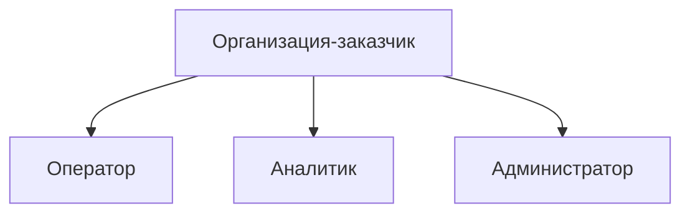
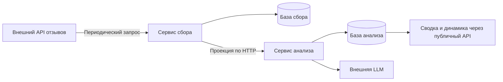
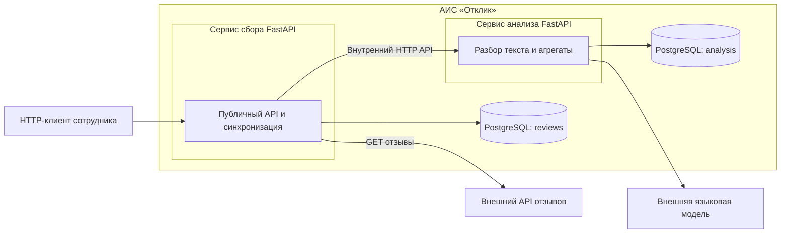
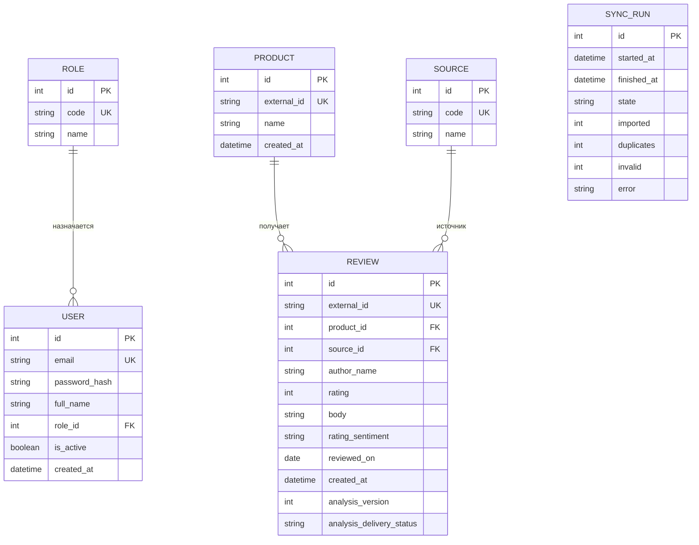
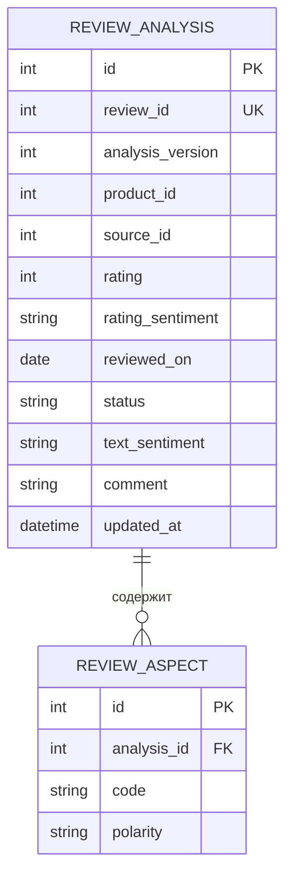

# Паспорт документа

| Реквизит | Значение |
| --- | --- |
| Код проекта | OTKLIK-01 |
| Наименование проекта | Автоматизированная информационная система сбора и анализа отзывов потребителей |
| Тип проекта | Создание автоматизированной системы |
| Класс проекта | Прикладная информационная система |
| Тип сложности | Низкая |
| Наименование бизнес-решения | Сбор и анализ отзывов потребителей |
| Наименование бизнес-системы | АИС «Отклик» |
| Название документа | Техническое задание на ИТ-решение |
| Версия документа | 1.0 |
| Дата документа | 24.10.2026 |
| Назначение документа | Зафиксировать цель, задачи, требования, сценарии и логическую модель данных серверной системы сбора и анализа отзывов |
| Аудитория | Команда разработки |

# 1. Термины и определения

| Термин | Определение |
| --- | --- |
| АИС «Отклик», система | Разрабатываемая серверная система из двух микросервисов и двух баз данных |
| Внешний сервис отзывов | Внешний HTTP-сервис, предоставляющий отзывы одного источника по согласованному контракту |
| Mock API | Имитатор внешнего API, возвращающий заранее подготовленные ответы для разработки и приёмки |
| Потребитель | Человек, оставивший отзыв во внешнем сервисе и не имеющий учётной записи в АИС |
| Оператор | Сотрудник, контролирующий автоматическую загрузку отзывов и при необходимости запускающий её вручную |
| Аналитик | Сотрудник, просматривающий отзывы, сводку и динамику |
| Администратор | Сотрудник, управляющий учётными записями и контролирующий синхронизации. Также имеет права оператора и аналитика |
| Товар | Объект из внешнего источника, о котором оставлен отзыв. Определяется внешним идентификатором |
| Источник | Справочная запись о происхождении отзыва. В MVP используется одна запись `external_api` |
| Оценка | Целое число от 1 до 5 из внешнего отзыва |
| Тональность по оценке | `negative` для оценок 1–2, `neutral` для 3, `positive` для 4–5. Вычисляется без модели |
| Аспект | Характеристика товара или обслуживания, выделенная LLM из текста, с положительной или отрицательной полярностью. Один отзыв может содержать до трёх аспектов |
| Разбор текста | Тональность текста, до трёх аспектов и короткий комментарий, полученные от языковой модели |
| Проекция отзыва | Копия только необходимых для аналитики полей отзыва в базе сервиса анализа, без исходного текста |
| Версия анализа | Число `analysis_version`, обеспечивающее соответствие результата текущему заданию на разбор |
| Статус передачи | `pending`, `sent`, `failed` — состояние доставки проекции из сервиса сбора в сервис анализа |
| Статус разбора | `pending`, `ready`, `failed` — состояние обработки принятой проекции языковой моделью |
| Сводка | Количество отзывов, средняя оценка, распределения и текстовый вывод по вычисленным агрегатам |
| Динамика | Количество отзывов и средняя оценка по дням, неделям или месяцам |
| Пользовательская история (US) | Потребность роли в форме «как роль, я хочу действие, чтобы результат» |
| Вариант использования (UC) | Сценарий с предусловиями, основным ходом, альтернативами и правилами |
| API | Интерфейс взаимодействия по HTTP/JSON |
| Задача проекта | Работа, которую необходимо выполнить в ходе создания системы |

# 2. Цель и задачи проекта

## 2.1. Цель

**Ц-1.** Сократить ручные трудозатраты на сбор и подготовку сводной оценки мнения потребителей за счёт автоматического получения отзывов из одного внешнего API, их сохранения и предоставления аналитической сводки с оценками, тональностью текста, аспектами и коротким выводом по одному запросу.

Цель одна. Проверяемые критерии её достижения приведены в п. 4.1.2 и 4.4.5.

## 2.2. Задачи

| ID | Цель | Задача (работа проекта) | Результат |
| --- | --- | --- | --- |
| З-1 | Ц-1 | Спроектировать раздельное хранение отзывов и результатов анализа | Две согласованные модели БД с ограничениями |
| З-2 | Ц-1 | Разработать сервис автоматического получения, хранения и предоставления отзывов | Загрузка из внешнего API, исключение дублей, публичный API |
| З-3 | Ц-1 | Разработать независимый сервис анализа текста, сводки и динамики | Обработка LLM и агрегаты по собственной БД |
| З-4 | Ц-1 | Реализовать аутентификацию и разграничение доступа сотрудников | Роли, токены и проверка разрешений |

Подробные функции указаны в разделе 4.

## 2.3. Декомпозиция задач

### З-1. Модель данных

| ID | Работа | Результат |
| --- | --- | --- |
| З-1.1 | Определить сущности двух баз | Базы `reviews` и `analysis` |
| З-1.2 | Задать первичные, внешние и уникальные ключи, допустимые оценки, статусы и версии анализа | Ограничения целостности |
| З-1.3 | Заполнить три роли и один источник `external_api`, создать первого администратора при запуске | База готова к импорту |

### З-2. Сервис сбора

| ID | Работа | Результат |
| --- | --- | --- |
| З-2.1 | Поднять FastAPI, подключить базу сбора и OpenAPI | Доступен публичный API |
| З-2.2 | Реализовать периодическую и ручную синхронизацию с одним внешним API, проверку дублей и сохранение | Автоматическое получение товаров и отзывов |
| З-2.3 | Реализовать выборки, сохранение истории синхронизаций и повторную передачу проекций сервису анализа | Отзывы доступны и поступают на анализ |

### З-3. Сервис анализа

| ID | Работа | Результат |
| --- | --- | --- |
| З-3.1 | Реализовать приём версий проекций и получение разбора текста от LLM | Тональность, аспекты, комментарий и статус |
| З-3.2 | Реализовать расчёт числовой сводки и получение краткого вывода по агрегатам | Операция сводки |
| З-3.3 | Реализовать расчёт динамики оценок без вызова LLM | Операция динамики |

### З-4. Доступ

| ID | Работа | Результат |
| --- | --- | --- |
| З-4.1 | Реализовать вход по почте и паролю и выдачу токена | Аутентификация |
| З-4.2 | Применить ролевую матрицу к операциям API | Контроль прав |
| З-4.3 | Реализовать управление учётными записями сотрудников | Администрирование |

## 2.4. Границы MVP

В объём входят только З-1…З-4 и пользовательские истории US-01…US-08. Интеграция реализуется с одним внешним источником по заданному контракту. Подключение площадок с другими контрактами требует адаптера.

В MVP не входят: фронтенд, подключение нескольких реальных внешних сервисов, веб-скрейпинг, отправка ответов покупателям, ручное исправление полученных отзывов, пакетный импорт файлов, обучение собственной модели, векторный поиск, брокер сообщений, API Gateway, отдельный сервис аутентификации и распределённое развёртывание.

# 3. Предметная область и исходные данные

## 3.1. Бизнес-правила

1. Отзывы поступают автоматически из одного внешнего REST API. Сотрудники АИС не должны переносить их вручную.
2. Каждый отзыв относится к одному товару и одному источнику `external_api`.
3. Оценка — целое от 1 до 5. Тональность по оценке вычисляется сервисом сбора:

   | Оценка | Код | Значение |
   | --- | --- | --- |
   | 1–2 | `negative` | Отрицательная |
   | 3 | `neutral` | Нейтральная |
   | 4–5 | `positive` | Положительная |

4. Одинаковый `external_id` отзыва повторно не создаётся. В MVP импортированные отзывы считаются неизменяемыми: пришедший повторно идентификатор пропускается, даже если прочие поля отличаются. Синхронизация изменений внешних отзывов не реализуется.
5. При первом появлении внешнего `product_id` сервис сбора автоматически создаёт товар. Для уже известного идентификатора используется сохранённая запись. Ручное создание и изменение товаров не предусмотрено.
6. Отзыв с пустым текстом, некорректной оценкой или датой в будущем пропускается с записью причины в журнал. Общий импорт продолжается. Имя автора обязательно.
7. Дата отзыва является календарной датой `YYYY-MM-DD`, не позже текущей даты в `Europe/Moscow`. По этой дате строится динамика.
8. Первичное сохранение товара и отзыва происходит в одной транзакции базы сбора. Ошибка анализа не отменяет принятый отзыв.
9. Каждый новый отзыв получает `analysis_version = 1`. Ручной повторный разбор увеличивает версию анализа. Исходный текст сохраняется без изменений. Результат предыдущей версии не считается актуальным.
10. Тональность текста и аспекты вычисляет LLM. Они могут отличаться от тональности по оценке. Пользователи не редактируют результаты LLM.
11. Числовая сводка считается по проекциям, уже доставленным в базу анализа. Если передача ещё идёт, сводка может временно отставать от базы сбора. В публичном ответе это отражает `is_complete`.
12. Для MVP не предусматриваются удаление отзывов и товаров, регистрация потребителей и права на отдельные товары.
13. Учётную запись сотрудника создаёт администратор. Доступ к API определяется его ролью.


### 3.1.1. Регулирование данных

АИС хранит имена и почту сотрудников, а также имена авторов отзывов, поступившие из внешнего источника. При работе с реальными персональными данными необходимо определить законное основание обработки и соблюдать применимые требования, в том числе Федерального закона РФ от 27.07.2006 № 152-ФЗ «О персональных данных». Для разработки, отладки и тестирования используются вымышленные имена и тестовые отзывы.

## 3.2. Организационный объём и роли



| Роль | Обязанности |
| --- | --- |
| Оператор | Проверяет результаты загрузки, может запустить синхронизацию и повторный разбор, читает каталог и отзывы |
| Аналитик | Фильтрует отзывы, запрашивает сводку и динамику |
| Администратор | Создаёт сотрудников, назначает роли, просматривает историю синхронизаций и имеет права остальных ролей |
| Потребитель | Оставляет отзыв во внешней системе и не является пользователем АИС |

## 3.3. Автоматизируемый процесс

| Код | Процесс | Изменение |
| --- | --- | --- |
| КП-01 | Сбор и анализ отзывов потребителей | Периодическое получение отзывов из внешнего API, сохранение новых записей и LLM-анализ текста |



| Шаг | Ранее | После внедрения |
| --- | --- | --- |
| Получение отзывов | Ручной перенос из внешнего источника | Автоматическая загрузка по REST API |
| Исключение дублей | Ручная проверка | По `external_id` отзыва |
| Определение тональности текста | Вручную либо не выполняется | LLM в сервисе анализа |
| Сводка и динамика | Ручной подсчёт | Запросы к публичному API |

## 3.4. Смежные проекты и системы

Смежных проектов нет. Внешний сервис отзывов и LLM предоставляют API для интеграции с микросервисами. При разработке и испытаниях допускаются совместимые имитаторы этих API.

# 4. Требования к системе

## 4.1. Назначение и критерии цели

### 4.1.1. Назначение

Система периодически получает отзывы и сведения о товарах из одного внешнего API, сохраняет их в сервисе сбора и передаёт проекции в сервис анализа. Анализ определяет тональность текста, аспекты и формирует статистику. Все действия сотрудников выполняются через публичный HTTP/JSON API сервиса сбора. Пользовательский веб-интерфейс в MVP не предусмотрен.

### 4.1.2. Критерии достижения Ц-1

| Показатель | Критерий проверки |
| --- | --- |
| Автоматический сбор | После запуска синхронизации новые тестовые отзывы появляются в БД сбора без ручного ввода каждого отзыва |
| Защита от дублей | Повтор синхронизации не увеличивает число записей при неизменном наборе внешних `id` |
| Получение сводки | Один запрос к публичному API возвращает числовые показатели и поле `conclusion` |
| Производительность | Список, числовая сводка без LLM и динамика на наборе из 10 000 отзывов — не более 2 секунд каждый в целевой конфигурации MVP |
| Изоляция отказов | Недоступность сервиса анализа не приводит к потере сохранённых отзывов. Отказ внешнего источника не мешает читать ранее полученные данные |

## 4.2. Бизнес-требования

| ID | Требование | Задачи |
| --- | --- | --- |
| БТ-1 | Отзывы поступают автоматически из одного API, не дублируются и доступны для выборки с фильтрами | З-1, З-2 |
| БТ-2 | Тексты разбираются языковой моделью. Показатели рассчитываются по собственной базе сервиса анализа | З-1, З-3 |
| БТ-3 | Сотрудники получают доступ к операциям только согласно назначенной роли | З-4 |

### 4.2.1. Пользовательские истории

**US-01.** Как сотрудник с учётной записью, я хочу войти в АИС, чтобы выполнять доступные моей роли операции. З-4.

**US-02.** Как оператор, я хочу просматривать каталог товаров, автоматически полученных из внешнего источника, чтобы понимать, к каким товарам относятся отзывы. З-1, З-2.

**US-03.** Как оператор, я хочу запускать синхронизацию и видеть её результат, чтобы контролировать автоматическое поступление отзывов и при необходимости повторять обработку. З-1, З-2, З-3.

**US-04.** Как аналитик, я хочу фильтровать отзывы и видеть готовый разбор текста, чтобы изучать мнения по товару, периоду, источнику и оценке. З-2.

**US-05.** Как аналитик, я хочу получать сводку по выбранным фильтрам, чтобы видеть число, среднюю оценку, тональность текста, аспекты и краткий вывод. З-1, З-3.

**US-06.** Как аналитик, я хочу получать динамику средней оценки по дням, неделям или месяцам, чтобы оценивать изменения мнения. З-1, З-3.

**US-07.** Как администратор, я хочу создавать сотрудников и назначать им роли, чтобы доступ соответствовал обязанностям. З-4.

**US-08.** Как администратор, я хочу просматривать историю синхронизаций с внешним сервисом отзывов, чтобы контролировать успешность загрузки и выявлять ошибки интеграции. З-2, З-4.

### 4.2.2. Сопоставление историй и вариантов использования

| Пользовательская история | Вариант использования |
| --- | --- |
| US-01. Войти | UC-01. Войти в систему |
| US-02. Смотреть товары | UC-02. Получить каталог товаров |
| US-03. Контролировать загрузку | UC-03. Синхронизировать отзывы |
| US-04. Фильтровать отзывы | UC-04. Получить список отзывов |
| US-05. Получить сводку | UC-05. Получить сводную аналитику |
| US-06. Получить динамику | UC-06. Получить динамику оценок |
| US-07. Назначить роли | UC-07. Управлять учётными записями |
| US-08. Контроль синхронизации отзывов | UC-08. Просмотр состояния синхронизации с внешним сервисом отзывов |

### 4.2.3. Связь цели, задач, историй и вариантов

| Цель | Задача | Истории | Варианты |
| --- | --- | --- | --- |
| Ц-1 | З-1 | US-02, US-03, US-05, US-06 | UC-02, UC-03, UC-05, UC-06 |
| Ц-1 | З-2 | US-02, US-03, US-04, US-08 | UC-02, UC-03, UC-04, UC-08 |
| Ц-1 | З-3 | US-03, US-05, US-06 | UC-03, UC-05, UC-06 |
| Ц-1 | З-4 | US-01, US-07, US-08 | UC-01, UC-07, UC-08 |

## 4.3. Функциональные требования

### 4.3.1. Функции

| ID | Функция | Поведение | История | UC | Требование |
| --- | --- | --- | --- | --- | --- |
| Ф-1 | Аутентификация | Вход по почте/паролю, выдача токена | US-01 | UC-01 | БТ-3 |
| Ф-2 | Каталог товаров | Отдаёт товары, поступившие из API | US-02 | UC-02 | БТ-1 |
| Ф-3 | Синхронизация отзывов | По расписанию или команде получает, проверяет и сохраняет отзывы, затем передаёт их на анализ | US-03 | UC-03 | БТ-1, БТ-2 |
| Ф-4 | Список отзывов | Фильтрует отзывы и добавляет актуальный готовый разбор | US-04 | UC-04 | БТ-1 |
| Ф-5 | Сводная аналитика | Считает показатели и запрашивает текстовый вывод по агрегатам | US-05 | UC-05 | БТ-2 |
| Ф-6 | Динамика | Группирует оценки по периодам | US-06 | UC-06 | БТ-2 |
| Ф-7 | Учётные записи | Создаёт сотрудников, меняет роль, имя, активность и пароль | US-07 | UC-07 | БТ-3 |
| Ф-8 | Контроль синхронизации | Предоставляет историю синхронизаций с временем запуска, статусом, числом загруженных отзывов и ошибками | US-08 | UC-08 | БТ-1 |

#### 4.3.1.1. Функциональная модель

Два микросервиса выделяются по независимой ответственности: получение и хранение отзывов должно работать отдельно от внешней LLM и аналитических вычислений. У каждого микросервиса собственный FastAPI и база данных.



| Сервис | Состав данных | Ответственность |
| --- | --- | --- |
| Сбор | Пользователи, роли, товары, источник, отзывы, история синхронизаций | Загрузка и исключение дублей, хранение истории синхронизаций, аутентификация, публичный API, доставка проекций, дополнение аналитики названием источника |
| Анализ | Проекции отзывов, результаты анализа, аспекты | Вызов LLM, сводка и динамика по собственной БД |

### 4.3.2. Интеграционные требования

#### 4.3.2.1. Внешний API отзывов

В MVP интеграция выполняется с одним внешним сервисом по описанному ниже HTTP-контракту. При разработке и приёмке используется совместимый Mock API. Подключение провайдера с другим контрактом требует адаптера.

Адрес задаёт `REVIEWS_API_BASE_URL`. Сервис сбора выполняет:

`GET {REVIEWS_API_BASE_URL}/api/v1/reviews?limit=100&cursor=<значение>`

В первом запросе `cursor` отсутствует. Параметр `limit` — целое от 1 до 100. Ответ имеет вид:

```json
{
  "items": [
    {
      "id": "ext-review-1001",
      "product_id": "ext-product-123",
      "product_name": "Беспроводные наушники",
      "author_name": "Иван",
      "rating": 2,
      "text": "Звук плохой, доставка задержалась",
      "created_at": "2026-10-20"
    }
  ],
  "next_cursor": "cursor-002"
}
```

`next_cursor` — непрозрачная строка для следующей страницы или `null`, если страниц больше нет. Внешний сервис предоставляет стабильную последовательность страниц в пределах одной синхронизации. Новые записи допускается показывать в следующем цикле. Параметр `cursor` интерпретируется только внешним API. Формат `created_at` — календарная дата `YYYY-MM-DD`.

| Поле | Тип | Условие |
| --- | --- | --- |
| `id` | строка | Обязательный непустой внешний идентификатор отзыва (до 128 символов) |
| `product_id` | строка | Обязательный непустой внешний идентификатор товара (до 128 символов) |
| `product_name` | строка | Название товара, 1–300 символов |
| `author_name` | строка | Имя автора, 1–200 символов |
| `rating` | целое | 1–5 |
| `text` | строка | 1–4000 символов |
| `created_at` | строка-дата | `YYYY-MM-DD`, не позже сегодняшней даты в `Europe/Moscow` |

Синхронизация запрашивает все страницы до `next_cursor = null`. Каждый запуск фиксируется в `sync_runs`. Повторные внешние `id` пропускаются. При ошибке страницы текущий запуск помечается как неудачный, успешно сохранённые записи остаются. Следующий запуск повторяет полный обход.

Для локального Mock API аутентификация не нужна. Если используется защищённый внешний API, секрет `REVIEWS_API_TOKEN` передаётся заголовком `Authorization: Bearer <token>` и не пишется в журнал. Получение HTTP-ошибок, неверного JSON и истечение времени ожидания считаются ошибкой синхронизации.

Загрузка выполняется по расписанию с интервалом `REVIEWS_SYNC_INTERVAL_SECONDS` (по умолчанию 7200 секунд), а также по команде оператора или администратора. Для MVP запускается один экземпляр сервиса сбора, одновременно выполняется не более одной синхронизации.

#### 4.3.2.2. Внутренний API и внешняя LLM

Публичный API принадлежит только сервису сбора: JSON/UTF-8, префикс `/api/v1`, OpenAPI в `/docs` и `/openapi.json`. Сервис анализа доступен только для внутреннего HTTP-взаимодействия. Межсервисный заголовок `X-Internal-Token` сверяется с `INTERNAL_TOKEN`. Пользовательские JWT во внутренний сервис не передаются.

Языковая модель вызывается сервисом анализа по контракту Chat Completions: `POST {LLM_BASE_URL}/chat/completions`. Переменные: `LLM_BASE_URL`, `LLM_API_KEY`, `LLM_MODEL`. Температура генерации установлена равной 0, если этот параметр поддерживается выбранной моделью.

При разборе одного отзыва в LLM передаются его текст и оценка. Ожидаемые поля ответа модели: `text_sentiment` (`positive`, `neutral`, `negative`), `aspects` (массив не более трёх уникальных кодов из набора `quality`, `delivery`, `price`, `service`, каждый с `polarity` `positive` или `negative`), `comment` (строка до 300 символов). При некорректном ответе разбор получает статус `failed`. Для текстового вывода сводки LLM получает агрегированные показатели без исходных текстов. Поле `conclusion` содержит до 500 символов на русском.

#### 4.3.2.3. Информационные потоки и согласованность

1. По расписанию или команде сервис сбора вызывает внешний API и постранично получает отзывы.
2. Для нового внешнего `id` сервис сбора в одной транзакции создаёт отсутствующий товар, сохраняет отзыв и ставит `analysis_version = 1`, `analysis_delivery_status = pending`. Тональность по оценке рассчитывается сразу.
3. Фоновая отправка выбирает записи со статусом передачи `pending` или `failed`, передаёт необходимые поля отзыва и текст сервису анализа с полями `review_id`, `analysis_version`, `product_id`, `source_id`, `rating`, `rating_sentiment`, `reviewed_on`, `text`.
4. Сервис анализа сначала сохраняет проекцию со статусом `pending`, затем отвечает `202 Accepted`. После успешного подтверждения сервис сбора помечает отправку как `sent`. Ответ `202` означает приём проекции.
5. После приёма сервис анализа в фоне вызывает LLM. При успехе сохраняет результат и `ready`, при ошибке — `failed`. Текст после обработки не записывается в базу анализа.
6. Если передача не удалась, сервис сбора сохраняет `failed` и повторяет попытку при следующем фоновом проходе (каждые 60 секунд) и при запуске приложения. Незавершённые записи не теряются при его перезапуске, потому что состояние находится в PostgreSQL.
7. Пара `review_id`/`analysis_version` делает передачу идемпотентной. Более старая версия не заменяет новую. Повторный приём той же версии не создаёт дубликат проекции или повторный вызов LLM, если обработка уже выполняется либо завершена. Сохранение ответа модели допускается только при совпадении версии задания с актуальной проекцией.
8. Ручной повторный разбор через API-10 увеличивает `analysis_version` в базе сбора, переводит передачу в `pending` и отправляет текущий неизменённый текст заново. Если фоновая задача LLM прервалась после подтверждённого приёма, оператор может запустить API-10. Гарантированная очередь выполнения LLM-заданий не входит в MVP.
9. При запросе списка сервис сбора возвращает собственные отзывы и добавляет результаты анализа только при совпадении версий. Если сервис анализа недоступен при чтении, поля разбора остаются пустыми, публичный статус — `unknown`. Список сохраняет работоспособность.
10. При запросе сводки/динамики сервис сбора проверяет права и обращается к сервису анализа. Тот агрегирует только свои проекции. Недоставленные отзывы ещё не входят в числовую статистику. Сервис сбора дополняет сводку названием источника из своей базы и полями `total_collected` (число совпавших отзывов у сбора) и `is_complete` (все соответствующие отзывы доставлены и учтены в проекциях текущей версии).

Принцип владения данными: сервис анализа не читает базу сбора, сервис сбора не читает базу анализа. Между БД нет внешних ключей. Внешний источник также не имеет доступа к локальным БД.

#### 4.3.2.4. Допущения MVP

- Используется один внешний источник и один экземпляр сервиса сбора. Одновременно выполняется одна синхронизация.
- Внешний API соответствует описанному контракту. Интеграция с площадками, использующими другие контракты, требует адаптера.
- Полученные отзывы неизменяемы. Исправления и удаления на стороне источника не синхронизируются.
- Сведения о запусках синхронизации записываются в таблицу `sync_runs` базы сбора. История доступна администратору и оператору через API-08 и сохраняется после перезапуска.
- Доставка проекций при сбое автоматически повторяется. Прерванный после приёма вызов LLM восстанавливается ручным повторным разбором через API-10.

### 4.3.3. Роли и права

| Операция | Администратор | Оператор | Аналитик |
| --- | --- | --- | --- |
| Вход | да | да | да |
| Чтение каталога товаров | да | да | да |
| Запуск синхронизации, просмотр её истории и статуса | да | да | нет |
| Чтение отзывов и готового разбора | да | да | да |
| Повторный разбор одного отзыва | да | да | нет |
| Сводка и динамика | да | нет | да |
| Управление сотрудниками | да | нет | нет |
| Чтение списка источников | да | да | да |

Создание и редактирование импортированных товаров и отзывов через публичный API не предусмотрено. В MVP используется один источник с неизменяемым кодом `external_api`. Ожидаемая нагрузка на управление доступом: один администратор и до пяти сотрудников каждой другой роли.

### 4.3.4. Варианты использования

Общие предусловия UC-02…UC-08: пользователь существует, активен, передал `Authorization: Bearer <JWT>` и имеет права на запрошенную операцию. Отсутствующий или недействительный токен вызывает ответ 401, недостаточные права — 403. Системный запуск по таймеру выполняется без пользовательского токена. Внешний сервис не получает доступ к публичному API АИС.

#### 4.3.4.1. UC-01. Войти в систему

**Связь:** US-01, Ф-1, З-4, БТ-3.

**Основной поток:** сотрудник передаёт почту и пароль. Сервис сбора проверяет активность учётной записи и хеш пароля, затем возвращает JWT, тип `bearer` и код роли.

**Альтернатива:** неверная почта, пароль или неактивная запись — 401 с одинаковым сообщением «Неверная почта или пароль» без уточнения причины.

**Правила:** JWT подписывается HS256 и действует 8 часов. Refresh-токен не используется. Секрет подписи хранится в переменной окружения. Пароль и хеш не возвращаются.

#### 4.3.4.2. UC-02. Получить каталог товаров

**Связь:** US-02, Ф-2, З-1, З-2, БТ-1.

**Основной поток:** пользователь передаёт параметры `limit` и `offset`. Сервис сбора возвращает страницу автоматически импортированных товаров и общее количество.

**Альтернативы:** пустая база или `offset` за пределами каталога — 200 с пустым `items`. Некорректные параметры пагинации — 422.

**Правила:** `limit` от 1 до 100, по умолчанию 20. `offset` — неотрицательное целое, по умолчанию 0. Товар создаётся только процедурой синхронизации, когда встретился новый `product_id` во внешнем API. Редактирование и удаление товаров в MVP не предусматриваются.

#### 4.3.4.3. UC-03. Синхронизировать отзывы

**Связь:** US-03, Ф-3, З-1, З-2, З-3, БТ-1, БТ-2.

**Предусловие:** настроен адрес внешнего API либо запущен соответствующий Mock API. Периодический запуск выполняется системой автоматически. Оператор и администратор могут инициировать внеочередную синхронизацию.

**Основной поток:**

1. Планировщик запускает синхронизацию по интервалу либо сотрудник вызывает API-07.
2. Сервис сбора запрашивает страницы внешнего API до `next_cursor = null`.
3. Для каждого элемента проверяются обязательные поля, оценка, дата и наличие текста.
4. Уже известный `external_id` отзыва пропускается. Если товар новый, создаётся запись `products`.
5. Новый отзыв сохраняется в `reviews` со статусом передачи `pending` и версией анализа 1.
6. Фоновая процедура доставляет проекцию сервису анализа и после подтверждения отмечает `sent`.
7. Сотрудник получает через API-08 состояние синхронизаций и счётчики загруженных, повторных и ошибочных записей.

**Альтернативы:** при недоступности внешнего API запуск получает статус `failed`, ранее сохранённые отзывы остаются доступны. Если один элемент не прошёл проверку, он пропускается, обработка остальных продолжается. Если синхронизация уже запущена, API-07 возвращает 409. Если сервис анализа недоступен, импорт завершается, доставка повторяется позднее.

**Повторный разбор:** оператор или администратор вызывает API-10 с идентификатором сохранённого отзыва. Сервис сбора увеличивает `analysis_version` и повторно передаёт данные на анализ. Текст отзыва остаётся неизменным.

**Правила:** импорт завершается независимо от выполнения LLM-анализа. Уникальность `external_id` предотвращает дублирование. Синхронизация не изменяет ранее сохранённые отзывы. Каждый запуск и его итог сохраняются в `sync_runs`.

#### 4.3.4.4. UC-04. Получить список отзывов

**Связь:** US-04, Ф-4, З-2, БТ-1.

**Основной поток:** сотрудник передаёт необязательные фильтры `product_id`, `source_id`, `rating`, `rating_sentiment`, `date_from`, `date_to`, `limit`, `offset`. Сервис сбора проверяет фильтры, возвращает страницу отзывов и `total`. Затем запрашивает результаты анализа для отзывов этой страницы. Порядок — `reviewed_on` по убыванию, затем `id` по убыванию.

**Альтернативы:** если ничего не найдено, возвращается 200 с пустым списком. Несуществующий идентификатор фильтра приводит к 404. При недоступности сервиса анализа отзывы возвращаются без готового разбора.

**Правила:** `limit` от 1 до 100, по умолчанию 20. `offset` — неотрицательное целое, по умолчанию 0. Готовый разбор возвращается при совпадении `analysis_version`. Если передача ожидает отправки, публичный статус — `pending`, если завершилась ошибкой — `failed`. После успешной передачи используется статус сервиса анализа. Когда сервис анализа недоступен при чтении, статус — `unknown`.

#### 4.3.4.5. UC-05. Получить сводную аналитику

**Связь:** US-05, Ф-5, З-1, З-3, БТ-2.

**Основной поток:**

1. Аналитик или администратор передаёт необязательные фильтры `product_id`, `source_id`, `date_from`, `date_to` и параметр `include_conclusion` (по умолчанию `true`).
2. Сервис сбора проверяет роль, идентификаторы и даты, затем вызывает внутреннюю сводку сервиса анализа.
3. Сервис анализа рассчитывает количество отзывов, среднюю оценку, распределения тональности по оценке и тексту, показатели по источнику и частоты аспектов. Все доставленные проекции участвуют в статистике по оценкам. Тональность текста и аспекты учитываются для проекций со статусом `ready`.
4. При `include_conclusion=true` LLM получает агрегированные показатели и формирует краткий `conclusion`. При ошибке LLM числовые данные возвращаются, а `conclusion = null`.
5. Сервис анализа возвращает показатели и идентификаторы источников. Для аспектов возвращаются их коды и соответствующие показатели.
6. Сервис сбора дополняет ответ отображаемым названием источника, значением `total_collected` из базы сбора и признаком `is_complete`.

**Альтернативы:** если подходящих проекций нет, система возвращает `total = 0`, `average_rating = null`, нулевые значения для всех трёх тональностей, пустые списки группировок и `conclusion = null`. Если сервис анализа недоступен, возвращается 503.

**Правила:** средняя оценка округляется до двух знаков после запятой по арифметическому правилу, при точной половине — в сторону от нуля. Доли тональности по оценке рассчитываются от всех доставленных проекций, по тексту — от проекций со статусом `ready`. В распределениях `positive`, `neutral`, `negative` присутствуют даже при нулевом количестве отзывов. Поле `total` содержит число доставленных проекций, `total_collected` — число отзывов, подходящих под те же фильтры в базе сбора. Признак `is_complete=true` устанавливается, когда для каждого отобранного отзыва существует проекция актуальной версии со статусом `ready` и `total = total_collected`. В остальных случаях он равен `false`.

#### 4.3.4.6. UC-06. Получить динамику оценок

**Связь:** US-06, Ф-6, З-1, З-3, БТ-2.

**Основной поток:** аналитик или администратор передаёт фильтры UC-05 и `period` (`day`, `week`, `month`, по умолчанию `week`). Сервис анализа группирует проекции по `reviewed_on`, считает число и среднюю оценку. Периоды отсортированы по возрастанию даты начала.

**Альтернативы:** при пустой выборке возвращается 200 с пустым списком. Неизвестный `period` вызывает 422, недоступность сервиса анализа — 503.

**Правила:** неделя начинается в понедельник по ISO 8601. Используются календарные месяцы. Интервалы без отзывов не включаются. LLM не вызывается. Динамика, как и сводка, может временно отставать от базы сбора до завершения доставки проекций.

#### 4.3.4.7. UC-07. Управлять учётными записями

**Связь:** US-07, Ф-7, З-4, БТ-3.

**Предусловие первого запуска:** если пользователей нет, сервис создаёт администратора из `ADMIN_EMAIL`, `ADMIN_PASSWORD`, `ADMIN_FULL_NAME`. Если данные не заданы, административный вход недоступен. Причина отражается в журнале.

**Основной поток:** администратор создаёт сотрудника с `email`, `full_name`, `password`, `role_code` (`admin`, `operator`, `analyst`). Сервис проверяет поля и уникальность почты, сохраняет хеш пароля и возвращает карточку без пароля.

**Альтернативы:** при дублировании почты возвращается 409. Изменение роли, имени, активности или пароля выполняется через `PATCH`. Попытка деактивировать свою учётную запись вызывает 422. Просмотр списка сотрудников возвращает страницу записей.

**Правила:** самостоятельная регистрация и удаление отсутствуют. Неактивный пользователь не может войти. Хеш пароля не возвращается.

#### 4.3.4.8. UC-08. Просмотр состояния синхронизации с внешним сервисом отзывов

**Связь:** US-08, Ф-8, З-2, З-4, БТ-1, БТ-3.

**Основной поток:** администратор вызывает API-08 и получает состояние текущей синхронизации и историю последних запусков. Для каждого запуска указываются время начала и завершения, статус, число загруженных отзывов, число дубликатов и отклонённых элементов, сведения об ошибке.

**Альтернативы:** если синхронизации ещё не проводились, возвращается 200 с пустой историей и состоянием `idle`. При недостаточных правах возвращается 403.

**Правила:** история хранится в таблице `sync_runs` базы сбора и остаётся доступной после перезапуска. Оператор может просматривать те же сведения для контроля загрузки в UC-03. Один экземпляр сервиса выполняет не более одной синхронизации одновременно.

### 4.3.5. Публичный HTTP API

Экранные формы отсутствуют. Все пути ниже относятся к сервису сбора и имеют префикс `/api/v1`. Описание контракта публикуется в `/docs` и `/openapi.json`.

| ID | Метод и путь | Назначение | Доступ | UC |
| --- | --- | --- | --- | --- |
| API-01 | `POST /api/v1/auth/login` | Получить токен | Без токена | UC-01 |
| API-02 | `GET /api/v1/users` | Список сотрудников | Администратор | UC-07 |
| API-03 | `POST /api/v1/users` | Создать сотрудника | Администратор | UC-07 |
| API-04 | `PATCH /api/v1/users/{id}` | Изменить сотрудника | Администратор | UC-07 |
| API-05 | `GET /api/v1/products` | Каталог импортированных товаров | Все роли | UC-02 |
| API-06 | `GET /api/v1/sources` | Список доступных источников | Все роли | UC-04, UC-05 |
| API-07 | `POST /api/v1/sync/reviews` | Запустить синхронизацию, ответ `202` | Оператор, администратор | UC-03 |
| API-08 | `GET /api/v1/sync/status` | Текущее состояние и история синхронизаций | Оператор, администратор | UC-03, UC-08 |
| API-09 | `GET /api/v1/reviews` | Список отзывов с результатами разбора | Все роли | UC-04 |
| API-10 | `POST /api/v1/reviews/{id}/analysis` | Повторить разбор неизменённого отзыва, ответ `202` | Оператор, администратор | UC-03 |
| API-11 | `GET /api/v1/analytics/summary` | Сводка и вывод | Аналитик, администратор | UC-05 |
| API-12 | `GET /api/v1/analytics/dynamics` | Динамика | Аналитик, администратор | UC-06 |
| API-13 | `GET /api/v1/health` | Состояние сервиса и зависимостей | Без токена | Диагностика |

Пагинируемые списки (`users`, `products`, `reviews`) возвращают `{ "items": [...], "total": 0, "limit": 20, "offset": 0 }`. Значение `limit` допускается от 1 до 100, `offset` — неотрицательное целое. По умолчанию используются `limit=20`, `offset=0`. Список источников не пагинируется.

Статусы ответов: 200 — чтение, 201 — создание пользователя, 202 — принятие фоновой команды, 401 — отсутствие или недействительность токена, 403 — недостаточно прав, 404 — неизвестный объект, 409 — конфликт уникальности или уже выполняющаяся синхронизация, 422 — некорректные поля, 503 — недоступна необходимая зависимость. Ответ `202` подтверждает приём команды. Результат фоновой операции проверяется отдельно.

API-08 возвращает `state` (`idle`, `running`, `success`, `failed`) и массив `runs` с последними запусками, отсортированными от новых к старым. Для каждого запуска указаны `started_at`, `finished_at`, `imported`, `duplicates`, `invalid`, `error`. При отсутствии запусков `state=idle`, `runs=[]`. Время завершения и ошибка могут быть `null`. По умолчанию возвращаются последние 20 запусков, параметр `limit` допускается от 1 до 100.

Публичный список отзывов включает сохранённые поля и `analysis_status` (`pending`, `ready`, `failed`, `unknown`), `text_sentiment`, `aspects`, `comment`. Готовый разбор добавляется при совпадении версий. `analysis_status` формируется сервисом сбора из статуса доставки и ответа сервиса анализа.

Публичная сводка содержит `total_collected` и `is_complete`, чтобы отображать полноту аналитических данных. Если `include_conclusion=false`, языковая модель не вызывается.

#### 4.3.5.1. Пример ответа списка отзывов (сокращённый)

```json
{
  "items": [
    {
      "id": 15,
      "external_id": "ext-review-1001",
      "product_id": 4,
      "rating": 2,
      "rating_sentiment": "negative",
      "body": "Звук плохой, доставка задержалась",
      "reviewed_on": "2026-10-20",
      "analysis_status": "ready",
      "text_sentiment": "negative",
      "aspects": [{"code": "delivery", "polarity": "negative"}],
      "comment": "Покупатель недоволен доставкой и качеством звука."
    }
  ],
  "total": 1,
  "limit": 20,
  "offset": 0
}
```

#### 4.3.5.2. Внутренние операции сервиса анализа

Внутренний сервис проверяет `X-Internal-Token`. Пути не включаются в публичный OpenAPI сервиса сбора.

| Метод и путь | Назначение |
| --- | --- |
| `POST /internal/reviews` | Идемпотентно сохранить текущую версию проекции и поставить разбор в фон, подтвердив приём кодом `202` |
| `GET /internal/analyses` | Вернуть разборы с версиями по переданным `review_id` |
| `GET /internal/analytics/summary` | Вернуть числа и, по параметру, вывод. Для источников вернуть ID и показатели, для аспектов — коды и показатели |
| `GET /internal/analytics/dynamics` | Вернуть точки динамики |
| `GET /internal/health` | Проверить доступность сервиса анализа и его БД |

Внутренняя сводка возвращает идентификатор источника и коды аспектов. Отображаемое название источника подставляет сервис сбора из своей БД. Сервис анализа не имеет прямого подключения к базе сбора.

#### 4.3.5.3. Требования к данным запросов

| Поле | Требование |
| --- | --- |
| Почта сотрудника | Непустая, уникальная |
| Пароль | 8–128 символов, хранится только хеш bcrypt или argon2id |
| Имя сотрудника | 1–200 символов |
| Код роли | `admin`, `operator`, `analyst` |
| `external_id` товара/отзыва | Строка 1–128 символов, уникальная в соответствующей таблице |
| Наименование товара | 1–300 символов |
| Имя автора | 1–200 символов |
| Текст | 1–4000 символов |
| Оценка | Целое 1–5 |
| Дата отзыва | `YYYY-MM-DD`, не позже текущей даты `Europe/Moscow` |
| Тональность | `positive`, `neutral`, `negative` |
| Коды аспектов, выделяемых LLM | `quality`, `delivery`, `price`, `service` |
| Полярность аспекта | `positive`, `negative` |
| Версия анализа | Положительное целое число, первичная версия 1 |
| Состояние передачи | `pending`, `sent`, `failed` |
| Статус анализа в БД анализа | `pending`, `ready`, `failed` |
| Период динамики | `day`, `week`, `month` |

## 4.4. Нефункциональные требования и приёмка

### 4.4.1. Нефункциональные требования

| ID | Требование |
| --- | --- |
| НФ-1 | Список, числовая сводка (`include_conclusion=false`) и динамика на 10 000 проекций выполняются каждый за ≤ 2 секунды |
| НФ-2 | Все операции, кроме входа и `health`, требуют JWT и проверки роли |
| НФ-3 | Пароли хранятся в виде хешей, секреты API/JWT/LLM — в переменных окружения |
| НФ-4 | Публичный интерфейс — HTTP/JSON FastAPI |
| НФ-5 | Недоступность внешнего API не мешает читать накопленные отзывы. Отказ анализа не отменяет импорт |
| НФ-6 | Повторная отправка проекций после сетевой ошибки выполняется не реже раза в 60 секунд и после перезапуска сервиса сбора |
| НФ-7 | Время ожидания одного вызова LLM — не более 20 секунд. Ошибка разбора даёт `failed`, ошибка формирования вывода — `conclusion = null` |
| НФ-8 | Отображаемый разбор и сохранённый ответ LLM относятся только к актуальному `analysis_version` |

### 4.4.2. Инфраструктура и конфигурация

Целевая конфигурация MVP: один сервер Linux (ориентир: 2 CPU, 4 ГБ ОЗУ, 20 ГБ диска), два процесса FastAPI/Uvicorn, PostgreSQL 16 с двумя раздельными базами. Mock API внешних отзывов и LLM могут запускаться отдельными тестовыми HTTP-процессами, не входящими в состав разрабатываемой АИС.

| Переменная | Назначение |
| --- | --- |
| `COLLECT_DATABASE_URL` | Подключение к БД `reviews` |
| `ANALYSIS_DATABASE_URL` | Подключение к БД `analysis` |
| `ANALYSIS_BASE_URL` | Внутренний адрес сервиса анализа |
| `INTERNAL_TOKEN` | Общий секрет межсервисного взаимодействия |
| `JWT_SECRET` | Секрет подписи JWT |
| `ADMIN_EMAIL`, `ADMIN_PASSWORD`, `ADMIN_FULL_NAME` | Данные первого администратора |
| `REVIEWS_API_BASE_URL` | Адрес единственного внешнего сервиса отзывов/его Mock API |
| `REVIEWS_API_TOKEN` | Необязательный токен источника, не используется тестовым Mock API |
| `REVIEWS_SYNC_INTERVAL_SECONDS` | Интервал автоматической загрузки (по умолчанию 7200) |
| `LLM_BASE_URL`, `LLM_API_KEY`, `LLM_MODEL` | Адрес, ключ и имя языковой модели |

Один экземпляр сервиса сбора использует один планировщик. Одновременный запуск нескольких синхронизаций блокируется.

### 4.4.3. Безопасность, диагностика и надёжность

- В локальной среде разработки допускается HTTP. При размещении в рабочем контуре используется HTTPS для публичных и внешних соединений. Токены передаются по защищённому каналу.
- Вызовы внутреннего анализа проверяют секрет `X-Internal-Token`, а публичные операции — JWT с HS256, выданный на 8 часов. Деактивированный сотрудник не допускается к API.
- `GET /api/v1/health` возвращает 200, если работает сервис сбора и его БД, или 503 при отказе БД сбора. Статусы внешнего API и сервиса анализа включаются в ответ отдельными полями и не препятствуют успешному ответу о работоспособности хранилища сбора.
- Журналы обеих служб содержат время, операцию, код результата и ошибки синхронизации и разбора. JWT, пароли, хеши и ключи LLM в журналы не записываются.
- Сервис анализа не хранит исходный текст отзыва после отправки LLM. Копирование необходимых полей проекции допускается без общих внешних ключей.
- Перед приёмкой создаются резервные копии обеих баз PostgreSQL. История синхронизаций, включая ошибки, сохраняется в базе сбора.

### 4.4.4. Состав поставки

Исходный код двух сервисов, инструкция настройки переменных окружения и запуска, OpenAPI публичного сервиса, Mock API отзывов, заглушка LLM для воспроизводимых проверок и настоящее ТЗ.

### 4.4.5. Порядок контроля и приёмки

Испытания выполняются HTTP-запросами и проверкой двух баз. Для функциональной приёмки Mock API содержит не менее трёх товаров и 15 текстовых отзывов с разными оценками, датами и формулировками. Отдельный набор из 10 000 отзывов используется для замеров производительности. Заглушка LLM должна возвращать известные ответы для контрольных текстов.

| ID | Проверка | Ожидаемый результат |
| --- | --- | --- |
| П-01 | Вход активного сотрудника и неверный пароль | Успешный JWT / единая ошибка 401 |
| П-02 | Роль без доступа вызывает сводку либо запускает синхронизацию | 403, операция не выполняется |
| П-03 | Запущен Mock API с 15 корректными отзывами и выполнена синхронизация | 15 отзывов и соответствующие товары автоматически созданы в БД сбора |
| П-04 | Повтор той же синхронизации | Число отзывов не изменилось, повторные `external_id` учтены как дубликаты |
| П-05 | Mock API вернул оценку 0, пустой текст и дату в будущем | Эти элементы пропущены, корректные сохранены. Причины отражены в журнале |
| П-06 | Заданный внешний API временно недоступен | Последняя синхронизация получает статус `failed`, уже загруженные отзывы доступны |
| П-07 | Сервис анализа остановлен во время успешного импорта | Отзывы сохранены. Доставка помечена `failed`. После восстановления повторная отправка доставляет проекции |
| П-08 | Заглушка LLM разбирает отзыв «Доставка сорвана» с оценкой 5 | Тональность по оценке `positive`, текста — `negative`, аспект `delivery/negative` |
| П-09 | Повторно отправлена та же пара `review_id`/`analysis_version` | Нет второго разбора и дублирующей проекции |
| П-10 | Оператор вызывает API-10 для отзыва и приходит устаревший ответ LLM | Версия увеличивается. Старый ответ не становится актуальным |
| П-11 | Получена страница отзывов с фильтром по товару и периоду | Состав страницы и `total` верны, готовые разборы актуальны |
| П-12 | Сводка по источнику и аспектам | Показатели рассчитаны по БД анализа. Коды аспектов и показатели получены из БД анализа, название источника добавлено из БД сбора |
| П-13 | Во время незавершённой доставки запрошена сводка | `is_complete=false`. `total_collected` показывает количество в БД сбора |
| П-14 | Отсутствуют проекции под фильтром | `total=0`, средняя оценка `null`, списки пусты, корректный 200 |
| П-15 | Отключена LLM для `conclusion` | Числовая часть доступна, `conclusion=null` |
| П-16 | Запрошена динамика по неделям | Периоды начинаются по понедельникам, количество и средние оценки верны |
| П-17 | Администратор создаёт пользователя и запрашивает историю синхронизаций через API-08 | Пользователь создан. История содержит сведения о завершённых запусках и доступна после перезапуска |
| П-18 | Список отзывов на наборе 10 000 записей | Время ответа ≤ 2 с |
| П-19 | Числовая сводка 10 000 проекций, `include_conclusion=false` | ≤ 2 с, без вызова LLM |
| П-20 | Динамика 10 000 проекций | ≤ 2 с, без вызова LLM |
| П-21 | Проверены `/docs` и `/openapi.json` | Есть все публичные операции API-01…API-13 |
| П-22 | Сервис анализа недоступен, база сбора работает | `health` отражает состояние зависимостей. Каталог и список сохранённых отзывов доступны |

Приёмка считается пройденной, если выполнены все проверки. Исполнитель оформляет краткий протокол «ID — факт — дата — результат».

# 5. Эксплуатация и границы сопровождения

Владелец данных — организация-заказчик. Развёртывание и настройку MVP выполняет команда разработки. Достаточные компетенции: Python, FastAPI, SQLAlchemy/Alembic, PostgreSQL, HTTP/JSON и интеграция с LLM по готовому контракту.

Развитием продукта могут стать подключение реальных сервисов с отзывами, синхронизация изменённых отзывов, автоматическое восстановление прерванных LLM-заданий, отдельное надёжное хранилище задач, фронтенд, уведомления. Это не включено в объём настоящего ТЗ.

# 6. Логическая модель баз данных

Модель данных находится в заключительном разделе ТЗ. Всего восемь сущностей: шесть в базе сервиса сбора `reviews` и две в базе сервиса анализа `analysis`. Между ними нет физических внешних ключей. Идентификаторы `external_id` описывают связь с внешним источником, а `review_id` в базе анализа является логической ссылкой на внутренний идентификатор отзыва из базы сбора.

## 6.1. Состав сущностей

| База | Сущность | Таблица | Назначение |
| --- | --- | --- | --- |
| `reviews` | Роль | `roles` | Коды доступа сотрудников |
| `reviews` | Пользователь | `users` | Сотрудники с учётными записями |
| `reviews` | Товар | `products` | Автоматически импортированный объект отзыва |
| `reviews` | Источник | `sources` | Одна запись внешнего источника `external_api` |
| `reviews` | Отзыв | `reviews` | Полученный текст, оценка, связи и состояние передачи |
| `reviews` | Запуск синхронизации | `sync_runs` | История запусков загрузки и результаты обработки |
| `analysis` | Разбор | `review_analyses` | Проекция и результат LLM без исходного текста |
| `analysis` | Аспект | `review_aspects` | Выделенный в тексте аспект и его полярность |

Идентификаторы внутренних строк — целые положительные числа. Внешние идентификаторы — строки. `datetime` хранится с часовым поясом, `reviewed_on` — календарная дата. Имена таблиц и обязательные поля зафиксированы ниже. Индексы запросов могут уточняться при реализации.

## 6.2. Атрибуты сущностей

### 6.2.1. Роль — `roles`

| Поле | Обязательное | Правило |
| --- | --- | --- |
| `id` | да | PK |
| `code` | да | UNIQUE, значения `admin`, `operator`, `analyst` |
| `name` | да | Отображаемое название |

### 6.2.2. Пользователь — `users`

| Поле | Обязательное | Правило |
| --- | --- | --- |
| `id` | да | PK |
| `email` | да | UNIQUE |
| `password_hash` | да | Хеш пароля |
| `full_name` | да | 1–200 символов |
| `role_id` | да | FK → `roles.id` |
| `is_active` | да | Логический признак, по умолчанию `true` |
| `created_at` | да | Момент создания |

### 6.2.3. Товар — `products`

| Поле | Обязательное | Правило |
| --- | --- | --- |
| `id` | да | PK |
| `external_id` | да | UNIQUE, внешний `product_id`, 1–128 символов |
| `name` | да | 1–300 символов, получено из API |
| `created_at` | да | Момент первого импорта |

Товар появляется автоматически при поступлении первого отзыва с новым `product_id`. Ручное изменение товара не предусмотрено.

### 6.2.4. Источник — `sources`

| Поле | Обязательное | Правило |
| --- | --- | --- |
| `id` | да | PK |
| `code` | да | UNIQUE, фиксировано `external_api` |
| `name` | да | Отображаемое название источника, задаваемое при развёртывании |

### 6.2.5. Отзыв — `reviews`

| Поле | Обязательное | Правило |
| --- | --- | --- |
| `id` | да | PK |
| `external_id` | да | UNIQUE, внешний `id` отзыва, 1–128 символов |
| `product_id` | да | FK → `products.id` |
| `source_id` | да | FK → `sources.id` |
| `author_name` | да | Имя потребителя, 1–200 символов |
| `rating` | да | Целое 1–5 |
| `body` | да | Текст отзыва, 1–4000 символов |
| `rating_sentiment` | да | `positive`, `neutral`, `negative` |
| `reviewed_on` | да | Дата внешнего отзыва, не позже текущей даты |
| `created_at` | да | Время первого импорта |
| `analysis_version` | да | Целое ≥ 1, при первом импорте 1 |
| `analysis_delivery_status` | да | `pending`, `sent`, `failed` |

Внешний отзыв не редактируется. Изменение `analysis_version` и `analysis_delivery_status` допускается без изменения данных самого отзыва. Вспомогательное время смены этих состояний не обязательно для MVP.

### 6.2.6. Запуск синхронизации — `sync_runs`

| Поле | Обязательное | Правило |
| --- | --- | --- |
| `id` | да | PK |
| `started_at` | да | Время начала синхронизации |
| `finished_at` | нет | Время завершения, `null` во время выполнения |
| `state` | да | `running`, `success`, `failed` |
| `imported` | да | Количество новых сохранённых отзывов, по умолчанию 0 |
| `duplicates` | да | Количество повторных отзывов, по умолчанию 0 |
| `invalid` | да | Количество отклонённых отзывов, по умолчанию 0 |
| `error` | нет | Краткое сообщение об ошибке запуска |

История синхронизаций доступна через API-08. Если процесс прерывается, незавершённый запуск при следующем старте сервиса помечается как `failed`.

### 6.2.7. Разбор — `review_analyses`

| Поле | Обязательное | Правило |
| --- | --- | --- |
| `id` | да | PK |
| `review_id` | да | UNIQUE, логическая ссылка на `reviews.reviews.id` |
| `analysis_version` | да | Целое ≥ 1 |
| `product_id` | да | Копия внутреннего ID товара |
| `source_id` | да | Копия внутреннего ID источника |
| `rating` | да | Копия оценки, 1–5 |
| `rating_sentiment` | да | Копия тональности по оценке |
| `reviewed_on` | да | Копия календарной даты |
| `status` | да | `pending`, `ready`, `failed` |
| `text_sentiment` | нет | `positive`, `neutral`, `negative` |
| `comment` | нет | До 300 символов |
| `updated_at` | да | Момент обновления текущей проекции |

Исходный текст `body` здесь не хранится. При получении новой версии текущий результат и аспекты заменяются, статус становится `pending`. Пока версия не получила статус `ready`, поля результата пусты.

### 6.2.8. Аспект — `review_aspects`

| Поле | Обязательное | Правило |
| --- | --- | --- |
| `id` | да | PK |
| `analysis_id` | да | FK → `review_analyses.id` |
| `code` | да | `quality`, `delivery`, `price`, `service` |
| `polarity` | да | `positive`, `negative` |

Уникальность пары (`analysis_id`, `code`) запрещает дублирующийся код аспекта. Максимум три аспекта проверяет сервис анализа.

## 6.3. Связи и кардинальности

| Связь | Кардинальность | Реализация |
| --- | --- | --- |
| Роль — пользователь | 1:N | `users.role_id` → `roles.id` |
| Товар — отзыв | 1:N | `reviews.product_id` → `products.id` |
| Источник — отзыв | 1:N | `reviews.source_id` → `sources.id` |
| Отзыв — разбор | 1:0..1, логическая | `review_analyses.review_id` + сопоставление `analysis_version`, без FK между БД |
| Разбор — аспект | 1:0..3 | `review_aspects.analysis_id` → `review_analyses.id` |

Связи между пользователем и отзывом нет: записи поступают без участия оператора.

## 6.4. ER-диаграммы

### 6.4.1. База сервиса сбора `reviews`

См. рисунок 4.



### 6.4.2. База сервиса анализа `analysis`
См. рисунок 5.


### 6.4.3. Межсервисная логическая связь

Для отзыва из `reviews.reviews` может ещё не существовать проекции в `analysis.review_analyses`. Когда проекция принята, `analysis.review_analyses.review_id` хранит `reviews.reviews.id` как логический идентификатор. Проверка пары (`review_id`, `analysis_version`) предотвращает использование устаревших результатов. Связь не является SQL FOREIGN KEY, поскольку таблицы находятся в разных базах и принадлежат разным сервисам.

## 6.5. Ограничения целостности

1. Первичные ключи и обязательность атрибутов задаются на уровне БД.
2. В БД сбора внешние ключи существуют только внутри неё: пользователь → роль, отзыв → товар/источник. Удаление связанных справочников и товаров не предусматривается.
3. В БД анализа FK существует только от аспекта к разбору. При замене результата удаление прежних аспектов и запись новых выполняются одной транзакцией.
4. В БД сбора уникальны `users.email`, `roles.code`, `products.external_id`, `sources.code`, `reviews.external_id`.
5. В БД анализа `review_analyses.review_id` уникален. Пара (`analysis_id`, `code`) аспектов уникальна.
6. Проверка диапазона оценки 1–5 выполняется и в `reviews`, и в `review_analyses`.
7. Значения тональности, статуса передачи, статуса разбора и полярности ограничены перечисленными кодами.
8. `analysis_version` — положительное целое в обеих базах. Проверка актуальности выполняется транзакционно при приёме проекции и сохранении результата LLM.
9. Длина текста и имён проверяется API до записи. Сервис анализа ограничивает число аспектов тремя.
10. Общие физические таблицы между микросервисами отсутствуют. Копии ID в аналитике используются для логического сопоставления и не являются внешними ключами.

## 6.6. Начальное наполнение

| Таблица | Начальные данные |
| --- | --- |
| `roles` | `admin` / Администратор, `operator` / Оператор, `analyst` / Аналитик |
| `sources` | `external_api` / Внешний сервис отзывов |
| `users` | Первый администратор из переменных окружения при пустой базе |
| `products` | Пусто — создаются по данным внешнего API |
| `reviews` | Пусто — создаются автоматической синхронизацией |
| `sync_runs` | Пусто — пополняется при каждом запуске синхронизации |
| `review_analyses`, `review_aspects` | Пусто — наполняются сервисом анализа |

Граница модели: дополнительные таблицы очередей заданий, аудита и ручной модерации не входят в MVP.

